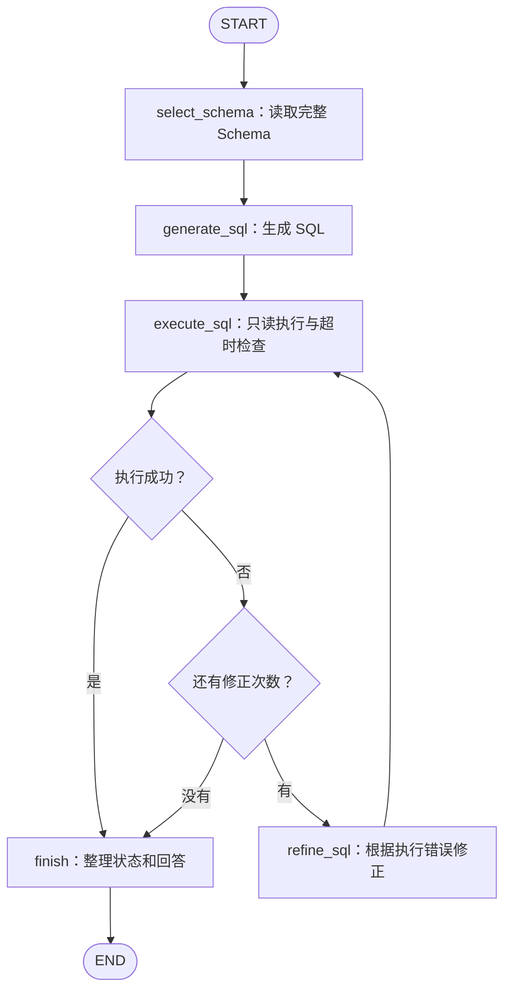

# LangGraph SQL 查询工作流

参考 MAC-SQL 的角色职责实现的个人学习项目。环境安装与目录总览见[项目首页](../README.md)。

当前支持：

- 从 SQLite 读取表结构和外键。
- 使用 DeepSeek 生成 SQL。
- 通过只读连接执行查询。
- 根据数据库错误修正 SQL，最多修正 3 次。
- 为每次 SQL 查询设置约 5 秒的执行时限。
- 在固定 30 道 Spider 题上进行回归评测。


## 1. 工作流程




主要状态字段：

- `question`、`db_id`：用户问题和数据库标识。
- `schema_text`、`foreign_keys`：表结构和外键。
- `sql`、`execution`：当前 SQL 和执行结果。
- `retry_count`、`max_retries`：已发起及允许的修正次数。
- `status`、`answer`：最终状态和回答。


## 2. 运行环境

已验证环境：

- Python 3.12.14
- langgraph 1.2.15
- langchain-deepseek 1.1.1

当前使用的 Python：

```text
/Users/liumingzhe/Desktop/LG/langchain-academy/.venv/bin/python
```

如需在另一个 Python 3.12 环境安装主要依赖：

```bash
python -m pip install -r requirements.txt
```

以上安装命令在项目根目录执行。原项目内的 Python 3.14 `.venv` 已清理；当前可用的 Academy 环境保持不变。

默认模型为 `deepseek-flash`，temperature 为 0，关闭思考模式。
可以通过环境变量 `DEEPSEEK_MODEL` 修改模型名称。

API Key 从 `DEEPSEEK_API_KEY` 环境变量读取；未设置时，
运行入口会提示隐藏输入。


## 3. 单题运行

在项目根目录执行：

```bash
cd "/Users/liumingzhe/Desktop/Learning Agent/MAC-SQL"
/Users/liumingzhe/Desktop/LG/langchain-academy/.venv/bin/python -m MAC_with_LangGraph.graph
```

修改 `graph.py` 中 `initial_state` 的 `question` 和 `db_id`
可以切换问题与数据库。

终端输出生成的 SQL、执行结果、最终状态和回答。


## 4. 固定 30 题回归

在项目根目录执行：

```bash
/Users/liumingzhe/Desktop/LG/langchain-academy/.venv/bin/python -m MAC_with_LangGraph.regression
```

这条命令会调用真实模型运行完整 30 题，并重执行旧预测进行比较。

需要准备：

- `data/spider/macsql_30.json`：固定题集。
- `data/spider/database/`：SQLite 数据库。
- `outputs/macsql_30/results.jsonl`：旧 MAC-SQL 预测。
- 项目同级目录 `din-sql/results/`：旧 Baseline 和 DIN-SQL 预测。


## 5. 已有评测结果

采用 2026-10-18 的完整运行记录：

```text
outputs/langgraph_30_20261018_175344_798075/
```

| 指标         | 结果           |
| ------------ | -------------- |
| SQL 执行成功 | 30/30          |
| 完整结果匹配 | 29/30（96.7%） |
| 模型调用尝试 | 30 次          |
| SQL 修正次数 | 0 次           |

评测比较完整查询结果：

- 标准 SQL 顶层有排序时，比较行顺序。
- 无排序时忽略行顺序，但保留重复行数量。
- 按固定列顺序比较，不要求 SQL 文本相同。
- 标准答案仅用于图外评测，不传给生成模型。

第 28 题遗漏 `DISTINCT`，导致养多只宠物的学生重复出现。
不能统一给所有查询添加 `DISTINCT`，因为部分题目需要保留重复行。

该成绩来自固定开发／回归集，不是独立测试集成绩。
新旧提示词和模型条件未完全统一，差异不能单独归因于 LangGraph。

该轮评测早于查询超时功能；超时功能已另行完成本地验证。

详细本地记录：`learning/LANGGRAPH_PROGRESS_2026-10-18.md`，作为个人笔记保留，不纳入 Git。

每轮回归输出 `results.jsonl`、`summary.json` 和 `report.md`；这些文件保存在本地 `outputs/`，不会随代码推送。

## 6. 当前范围与限制

- 小数据库直接提供全部 Schema，尚未进行模型筛选。
- 提示词经过简化，不是原 MAC-SQL 全部行为的严格复现。
- 修正由 SQL 执行错误触发，不能自动识别所有语义错误。
- 单题运行中的模型调用异常直接抛出，由运行者排查；
  批量回归入口会记录单题异常并继续评测。
- 暂不记录 token 用量。
- RAG、模型自主选择工具、记忆和界面属于后续阶段。
