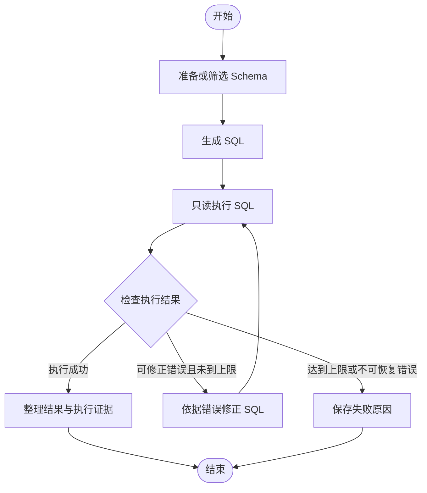

# 下一阶段项目说明：用 LangGraph 重构 MAC-SQL，并逐步扩展为数据分析 Agent

原规划日期：2026-10-13；当前状态说明更新于 2026-10-19。
适用起点：已完成 MAC-SQL 学习与小样本复现，已学完 LangGraph Academy Module 1、2。

> 当前实现为 `MAC_with_LangGraph/`，已完成查询流程、约 5 秒 SQL 执行时限、最多 3 次修正、单题演示和正式回归入口。沿用 2026-10-18 的 29/30 历史结果。
>
> 第一阶段按当前约定收尾：模型调用异常由运行者排查，暂缓 token 统计、完整节点日志及统一异常出口；不再把这些原规划项目作为进入下一阶段的前置要求。下一阶段为业务口径 RAG。
>
> 2026-10-19 清理后，旧 `core/`、评测器和训练／演示脚本已移出当前目录，可在[清理前提交](https://github.com/imliumingzhe6150/MAC-SQL/tree/1ad71be68fbf8a9545a2fedf1fef4c18bea002e2)查阅。旧笔记见 [learning/archive/macsql/](learning/archive/macsql/README.md)。下文保留原始规划，旧路径和未勾选清单不代表当前进度；实际运行以 [README](README.md) 为准。

## 1. 现在要做的项目

先完成一个 **LangGraph 版 MAC-SQL 最小可运行版本（MVP）**：输入自然语言问题和数据库标识，系统准备表结构、生成 SQL、执行查询；执行出错时根据错误修正 SQL；最后返回查询结果，或者明确说明为什么失败。

这一阶段的核心训练是：把你已理解的业务流程实现为节点、共享 State、条件路由和有上限的循环，并留下可检查的运行记录。

后续项目方向是“面向业务数据的分析助手”：在查询能力之上，加入业务口径检索、模型调用工具、统计分析、图表和有证据支持的报告。当前 MVP 是这个项目的查询模块，也是你复用 DIN-SQL、MAC-SQL 学习成果的起点。

**完成标准不是看完课程，而是能够运行、解释、检查和比较自己实现的系统。**

## 2. 复用你已经完成的工作

下表依据当前本地仓库核对。已有实验结果以原始记录为准；本说明没有重新调用模型，也没有重新计算历史准确率。

| 现有文件或目录                       | 已有内容                                | 下一阶段怎么用                                 |
| ------------------------------------ | --------------------------------------- | ---------------------------------------------- |
| `core/chat_manager.py`             | 通过 `send_to` 和轮次循环调度三个角色 | 对照理解原调度方式，把调度改写为图             |
| `core/agents.py`                   | Selector、Decomposer、Refiner           | 复用角色职责、提示词组织与数据处理思路         |
| `core/const.py`                    | 提示词与常量                            | 优先保留原提示词，减少同时变化的因素           |
| `core/utils.py`                    | SQL 解析等辅助逻辑                      | 阅读后选择性复用，记录行为差异                 |
| `data/spider/macsql_30.json`       | 固定的 30 道 Spider 题                  | 用作开发／回归集，不重新凑一套 20 题           |
| `outputs/macsql_30/`               | 30 条历史结果及运行记录                 | 保留作为历史参照；新结果写入新目录             |
| `README.md`                        | 已有小样本对比说明                      | 用相同口径整理新阶段结果，保留旧结论的实验条件 |
| `LEARNING_GUIDE.md`                | 原项目学习指南                          | 复习实现细节与已有实验设计                     |
| `learning/STAGE_A_DELIVERABLES.md` | 字段说明、路由与执行流程                | 帮助设计新 State 和迁移检查项                  |

当前固定题集包含 `concert_singer` 的 21 题和 `pets_1` 的 9 题。先在 `concert_singer` 上调通，再扩展到这两个已有数据库。

特别注意输入字段：**原始 Spider 数据里的 `question` 是自然语言问题，`query` 是标准 SQL。** 原 MAC-SQL 运行消息里的 `query` 又表示自然语言问题。新代码统一使用 `question` 表示用户问题，避免把标准答案误传给模型。

## 3. 第一版的范围

### 必须完成

- 输入一条问题和 `db_id`，从本地 SQLite 数据库获得查询结果。
- 用 LangGraph 显式表示 Schema 准备、SQL 生成、执行、修正和结束路径。
- 复用现有 MAC-SQL 提示词，接入你已验证可用的 DeepSeek 配置。
- 为查询设置只读约束、执行时间限制和明确的错误输出。
- 为 SQL 修正设置上限，确保每次修正后都重新执行验证。
- 输出 SQL、结果预览、终止状态和失败原因；记录节点轨迹与调用用量。
- 在已有 30 题上做回归，检查结果正确性与迁移差异。

### 完成 MVP 后再逐项增加

业务口径 RAG、模型自主选择工具、统计图表、多轮任务、人工确认、跨会话偏好记忆和界面。第一版不把这些全部列为开工前提。

初期用命令行即可。最终回答可以先用模板整理 SQL、结果和状态，避免为了润色回答额外调用一次模型。

## 4. 第一版流程图



图中的“执行成功”只表示数据库接受了 SQL，**不表示 SQL 回答了正确的问题**。语义正确性通过独立的回归评估和人工检查判断。

Schema 加载失败、模型调用失败、模型没有返回可解析 SQL 等异常，也必须进入明确的失败出口。不能让程序因未处理异常退出后，被日志误记为成功。

## 5. 从原 MAC-SQL 映射到 LangGraph

| 原实现                          | 新实现建议                  | 迁移时要理解的事                                                   |
| ------------------------------- | --------------------------- | ------------------------------------------------------------------ |
| 同一个消息字典在角色间原地修改  | 有明确字段的 State          | 节点返回本次更新的字段，避免无意覆盖其他状态                       |
| `Selector.talk()`             | `select_schema` 节点      | 小 Schema 可以直接保留全部表列，不强制增加一次模型调用             |
| `Decomposer.talk()`           | `generate_sql` 节点       | 当前 Spider 分支主要生成最终 SQL；不把它描述为会执行子问题的规划器 |
| Refiner 内部执行 SQL            | 独立的 `execute_sql` 节点 | 单独记录 SQL、执行状态、数据与错误                                 |
| Refiner 根据错误调用模型        | 独立的 `refine_sql` 节点  | 修正与执行分开，修正后始终回到执行节点                             |
| `send_to` 和 ChatManager 循环 | 普通边与条件边              | 下一跳由图控制，避免同时保留两套实际调度器                         |
| `MAX_ROUND`、`try_times`    | 定义清楚的修正预算和计数    | 原字段含义不能直接等同于“修正模型调用次数”                       |

第一版可以通过薄适配层复用旧逻辑，也可以提取成较小的函数。注意旧类内部存在共享字典、全局模型函数等状态；新节点的输入输出应当清楚，不能依赖看不见的跨题残留状态。

### 当前代码中值得主动处理的边界

1. `Refiner._execute_sql()` 返回的是前 5 行预览。预览可以展示给用户，但不能拿它代替完整查询结果进行正确性评估。
2. 原调度达到轮次上限时，最后生成的修正 SQL 可能尚未执行。新流程必须标明“已验证”或“未执行”，不能直接当作成功结果。
3. 原超时处理存在异常后继续使用 `error_info` 的风险。新执行节点应返回统一错误结构，路由不读取未初始化字段。
4. 空结果和 `NULL` 可能合法。不能仅凭“没有数据”就判断 SQL 错误、无限修正。
5. `ChatManager` 初始化会调用 `ping_network()`。新入口不必额外调用模型问候；若保留连通性检测，应单独计入调用成本。

这些属于执行边界和记录方式的改进。评估时将它们与“替换调度框架”分别说明，不能把所有变化都归因于 LangGraph。

## 6. State 的建议设计

字段类型与名称可以调整，但每个字段必须有明确的写入者和含义。

| 字段             | 建议含义                                                       | 主要写入节点                     |
| ---------------- | -------------------------------------------------------------- | -------------------------------- |
| `question_id`  | 当前样本的稳定标识                                             | 输入适配                         |
| `question`     | 自然语言问题                                                   | 输入适配                         |
| `db_id`        | 数据库标识                                                     | 输入适配                         |
| `evidence`     | 用户提供的可选背景信息                                         | 输入适配                         |
| `schema_text`  | 给模型使用的表列描述，对应旧 `desc_str`                      | `select_schema`                |
| `foreign_keys` | 外键说明，对应旧 `fk_str`                                    | `select_schema`                |
| `sql`          | 当前候选 SQL，统一承接旧 `final_sql`／`pred` 的用途        | `generate_sql`、`refine_sql` |
| `execution`    | 当前 SQL 的执行状态、列名、行数、预览、错误与是否截断          | `execute_sql`                  |
| `retry_count`  | 已发起的 SQL 修正请求次数，初始为 0                            | `refine_sql`                   |
| `max_retries`  | 本题允许的 SQL 修正请求上限，首版建议为 2                      | 输入配置                         |
| `status`       | `running`、`succeeded` 或 `failed`；成功仅指执行流程完成 | 路由／结束节点                   |
| `answer`       | 最终输出摘要或失败说明                                         | 结束节点                         |
| `trace`        | 节点执行事件、耗时、SQL 版本与错误记录                         | 各节点                           |

设计约定：

- 每次 SQL 改变后，旧的执行结果不再代表新 SQL。清空旧结果或以 SQL 版本绑定执行记录。
- `retry_count` 在发起修正请求时计数；即使返回内容解析失败，也消耗这次预算。
- `max_retries=2` 表示首次生成后最多再修正两次。正常路径最多执行三版 SQL，不是调用三个节点就算一次重试。
- API 网络重试与 SQL 修正是两种重试，分别限次、分别记录，避免请求层无限重试。
- 若 `trace` 使用追加式 reducer，节点只返回本次新增事件，避免重复追加整段历史；其他单值字段通常覆盖更新即可。
- 标准 SQL 和参考结果只留在离线评测侧，不放入生成节点可见的 State 或提示词。

先做单次任务 State。用到跨轮会话后，再引入消息列表、`thread_id` 和 checkpoint；不能仅因为使用 State 就宣称具有长期个人记忆。

## 7. SQL 执行工具的最低要求

执行工具由程序实现，模型只生成查询与修正建议。

- 数据库使用只读连接，并在执行层限制写操作；只在提示词中写“请勿修改数据”不构成约束。
- 一次处理一条查询，正常支持 `SELECT` 和只读的 `WITH` 查询；不能只用“是否以 SELECT 开头”来判断所有合法查询。
- 查询必须有可终止的时间限制。SQLite 连接的锁等待 `timeout` 不等于查询执行时限；可以使用进度回调或可终止的独立执行进程落实。
- 执行返回结构化结果，并关闭连接。至少区分成功、SQL 错误、超时、权限拒绝和数据库不存在。
- 展示结果可以截断并明确标记；离线评估应独立执行完整结果比较。不能偷偷给预测 SQL 加 `LIMIT` 后再宣称与原查询等价。
- 每次执行后都记录所执行的 SQL，失败时也保留错误信息，便于复现。

## 8. 推荐目录与环境

以下是后续实现时的建议结构，本文没有创建这些代码文件。按里程碑逐步新增即可。

```text
MAC-SQL/
├── core/                          现有实现，保留作为参照
├── data/spider/                   已有题集与数据库
├── langgraph_app/                 新实现
│   ├── __init__.py
│   ├── state.py                   State 定义
│   ├── nodes.py                   Schema、生成、修正、结束节点
│   ├── graph.py                   建图与条件路由
│   ├── llm.py                     DeepSeek 调用与用量记录
│   ├── sql_executor.py            只读执行与错误规范化
│   ├── run.py                     单题入口
│   └── regression.py              批量回归入口
├── tests/                         路由、终止与执行边界测试
├── requirements-langgraph.txt     新实现的依赖记录
├── outputs/langgraph_mvp/         新实验记录，按运行批次分目录
└── NEXT_STEP_LANGGRAPH_PROJECT.md 本说明
```

当前原仓库的 `requirements.txt` 固定了 `openai==0.28.1`。新 LangChain 接入包可能需要另一套 SDK 依赖，因此新实现使用单独的 Python 3.12 环境，例如 `.venv-langgraph`；不要把旧环境直接升级成新框架环境。

新环境按实际使用的模块安装依赖，成功运行后记录版本。选择性复用旧函数时，也要检查它们的导入依赖；只复制调用语句并不保证旧模块在新环境里兼容。

模型名、接口地址和参数沿用你当前已验证可用的 DeepSeek 配置，并在每次实验中记录。API Key 由环境变量读取，不能写进源码、日志、说明文件或 Git。新虚拟环境与密钥文件加入忽略规则。

## 9. 实施顺序与逐步验收

### 里程碑 1：不用模型，先把图跑通

写出 State、建图函数和最小节点。生成节点暂时返回一条手写的合法 SQL，在 `concert_singer` 上执行。

验收：

- [ ] 输入一道题，可以看到 Schema、生成、执行和结束的节点顺序。
- [ ] SQL 与执行结果一起输出，结果来自实际数据库查询。
- [ ] 查询失败时可以进入明确的失败或修正路径。
- [ ] 你能逐个解释节点读写了哪些 State 字段。

这一步使用模拟的模型返回值，不需要 API 费用，也不计为模型能力评测。

### 里程碑 2：接入真实 SQL 生成

把生成节点接入 DeepSeek，优先沿用 MAC-SQL 的 Schema 文本、外键说明和 Spider 提示词。先跑简单题、JOIN 题和聚合题各一题；挑选调试题时记录其来源。

验收：

- [ ] 问题与表结构正确传入模型，标准 SQL 未进入提示词。
- [ ] 模型响应可以提取 SQL，解析失败时有明确输出。
- [ ] 每道题记录实际模型调用次数和用量；供应商没有返回的用量标为缺失，不能凭空补数。
- [ ] 小数据库的 Selector 没调用模型时，仍然能提供完整 Schema。

### 里程碑 3：完成可终止的执行修正循环

接入 `refine_sql`，将执行错误连同当前 SQL、问题和 Schema 提供给模型。每次新 SQL 都回到执行节点。

验收：

- [ ] 首次执行成功，直接结束，不额外调用修正模型。
- [ ] 构造一次错误列名，确认错误被记录，修正后确实重新执行。
- [ ] 使用模拟模型持续返回错误 SQL，确认两次修正后必定停止。
- [ ] 最后一次修正成功可以正常返回；最后一次仍失败时明确标记失败。
- [ ] 空结果是合法成功结果；超时、权限拒绝和模型异常不会被标为成功。

有意构造的故障题只用于机制验证，单独保存；不要将它们混进原 30 题来计算或宣传准确率。

### 里程碑 4：跑已有 30 题回归并解释差异

扩展到 `concert_singer` 和 `pets_1`，在固定的 `macsql_30.json` 上逐题保存预测和评估结果。先检查输入转换与文件输出，再开始真实 API 批量调用。

验收：

- [ ] 30 题都保留记录，包括失败题和超时题，不能只统计成功样本。
- [ ] 使用与旧结果一致且明确的结果比较口径。
- [ ] 对所有新旧结果差异给出原因或“尚未确定”的说明。
- [ ] 保存至少一条正常轨迹、一条修复成功轨迹和一条明确失败轨迹；如来自故障注入，必须标注。
- [ ] 汇总执行成功率、结果匹配率、调用量、token 用量和耗时。

### 里程碑 5：整理可展示的交付物

- [ ] 写明环境安装、单题运行和批量回归的实际命令。
- [ ] 输出一张系统流程图，以及关键节点和 State 的解释。
- [ ] 提交一份逐题结果表、一份汇总表和一页错误分析。
- [ ] 列出相对原 MAC-SQL 的实际改动、还没解决的问题和下一项改进。
- [ ] 用一次完整演示说明“问题 → SQL → 数据 → 输出／失败原因”。

达到这里，第一阶段可以结束。下一阶段扩展以实际发现的问题为依据。

## 10. 怎么评估，才能说明你做了什么

### 先分清三种检查

| 检查            | 输入                         | 能说明什么                                       |
| --------------- | ---------------------------- | ------------------------------------------------ |
| 路由和边界测试  | 固定的模拟模型回复、故障 SQL | 图有没有走对、修正上限有没有生效，不衡量模型水平 |
| 30 题开发／回归 | 已用过的固定 Spider 题       | 新实现是否退化、哪里有差异，不是独立泛化评测     |
| 后续留出测试    | 预先保留且没有用于调试的新题 | 对未调试样本的表现；仍需说明样本量和适用范围     |

已有 README 中的结果是历史参照。如果当前模型版本、提示词、参数或数据库变化，不能直接把旧数字和新数字解释为框架效果。预算允许时，用统一条件重新运行原流程和新流程；预算不足时，明确写“历史参照，条件未完全控制”。

对比时固定问题、数据库、模型及思考模式、提示词、SQL 解析规则、重试预算和评测方法。原实现的轮次上限与新实现的修正上限并非天然相等，必须说明如何对应。即使参数相同，模型服务也可能存在输出波动，因此不要求两次 SQL 字符串逐字一致。

### 指标口径

- **执行成功率**：实际执行成功的题数 / 全部题数。
- **结果匹配率**：预测 SQL 的完整执行结果与参考结果匹配的题数 / 全部题数。
- **修复表现**：仅在首次执行失败且进入修正的题上统计修复后执行成功率；另记修复后结果是否正确，不能混为一个指标。
- **开销**：记录模型调用、API 层重试、SQL 执行次数、token 用量和每题耗时；缺失信息明确标注。
- **错误类型**：Schema、SQL 解析、表列名、连接、聚合、语义、超时和调用失败等。

结果比较不能只比较 SQL 字符串。遵循已有实验约定：有排序要求时检查行顺序，无排序要求时忽略行顺序但保留重复行计数。浮点数容差、`NULL` 和列对应规则也要统一记录；不要在新旧版本上使用不同的比较逻辑。

执行结果相同不构成所有数据库上的语义等价证明。对典型错题和可疑“偶然匹配”进行人工检查。已有提示词中出现过的示例题应标注，不当成未见过的独立题目。

**迁移本身不保证准确率提升。** 如果准确率相近，但循环可靠终止、状态更清楚、错误能定位、运行能复现，这仍然是明确的工程成果。若观察到准确率变化，应通过受控对照判断原因。

## 11. MVP 后怎么扩展到你想做的 Agent

每次只增加一个能力，并为它增加对应验收。以下是建议顺序，可以根据实际错误分析调整。

| 阶段            | 增加的能力                                     | 具体任务示例                                       | 怎么验收                                                 |
| --------------- | ---------------------------------------------- | -------------------------------------------------- | -------------------------------------------------------- |
| A：当前 MVP     | SQL 查询与执行修正                             | “各体育场举办了多少场演唱会？”                   | SQL、完整结果、执行轨迹、固定题回归                      |
| B：业务口径 RAG | 检索指标定义、字段说明和规则                   | “净销售额是否扣除退款？”先检索口径，再查询       | 检索是否找到正确规则、引用是否支持结论、与无检索版本对照 |
| C：工具选择     | 模型根据任务选择文档检索、数据库查询或统计计算 | 定义问题查文档，数值问题查库，比较问题调用统计函数 | 检查工具选择、参数、执行反馈和停止条件                   |
| D：分析与图表   | 对真实查询结果做分组、趋势和贡献分析           | “本月销售变化主要来自哪些商品类别？”             | 数字能复算、图表对应数据、结论不超出证据                 |
| E：报告与交互   | 有来源的短报告、多轮追问、必要时澄清           | “按新口径重新比较，并生成图表说明。”             | 记录口径变化，报告能追溯到文档和查询结果                 |

业务分析扩展阶段应选一个具有时间、订单、商品或渠道字段的小型电商／零售数据场景。当前 Spider 数据适合验证查询流程，不必硬把所有数据库解释成商业经营分析任务。新场景、指标字典和参考问题单独维护，避免破坏原回归口径。

注意两个区别：

1. 程序按固定流程调用 `execute_sql`，与模型通过工具 schema 自主选择工具、填写参数并读取结果，是不同的实现。简历中的 tool calling 能力以实际完成的后一种机制为依据。
2. 取出 Schema 放进提示词，不自动等于做了完整 RAG。业务口径 RAG 要能说明文档如何组织、如何检索、检索结果如何影响回答，以及如何评估。

个人记忆可以以后保存默认业务口径、常用时间范围或展示偏好；必须考虑不同用户的区分及偏好更新。当前单次 SQL 任务无需为了“有记忆”而先实现整套长期存储。

## 12. 后续课程怎么穿插

| 内容        | 学习时机                       | 对应项目用途                                |
| ----------- | ------------------------------ | ------------------------------------------- |
| Module 1、2 | 现在直接应用，遇到问题回看     | 节点、条件边、State、reducer 和基础记忆概念 |
| Module 3    | 基础流程跑通后按需学习         | 流式进度、状态修改和人工介入                |
| Module 4    | 开始组合查询、检索、分析模块时 | 子图、并行和较复杂任务组织                  |
| Module 5    | 有明确跨会话记忆需求时         | 长期记忆与用户偏好                          |
| Module 6    | 本地演示稳定后                 | 部署与连接服务                              |

不用把全部课程、RAG 教程和 Agent 框架都学完再开始 MVP。先用项目暴露问题，再针对问题补知识。

课程目录：[Introduction to LangGraph](https://academy.langchain.com/courses/intro-to-langgraph)
课程代码：[LangChain Academy](https://github.com/langchain-ai/langchain-academy)

## 13. 怎样形成实习或科研材料

第一阶段完成后，可以据实描述“基于 MAC-SQL 重构 LangGraph 查询流程，实现显式状态传递、只读执行、有界修正和逐题运行记录”。结果数字必须来自保存的实验，不能把计划中的 RAG、记忆、工具选择写成已完成能力。

面向实习，逐步补充可运行演示、失败处理、开销记录和对业务问题的解释。面向科研，在基础系统稳定后选一个具体问题，例如某类检索错误如何影响 SQL，或修正策略如何在固定调用预算内影响结果；为一个变量设计对照实验，再考虑扩大样本和总结结论。

“套上 LangGraph”本身不是算法创新；实现过程中可验证的改进、严谨比较和错误分析才是需要展示的部分。小样本学习实验也不能直接包装成论文级结论。

如果同时投数据分析岗位，自己仍需能核验 SQL、解释指标口径和完成分析案例。Agent 做出的图表与结论，也要由你判断是否正确。

## 14. 第一次动手的 90 分钟

下面是建议的练习安排，不是必须按时完成的进度承诺。

1. **前 20 分钟：**画出第一版图，列出 State，定义“执行成功”“修正次数”“失败退出”的含义。
2. **接着 30 分钟：**创建新模块，使用模拟生成节点连接 Schema、执行与结束节点。
3. **接着 25 分钟：**在 `concert_singer` 上跑一条手写 SQL，输出列名、结果和执行状态。
4. **最后 15 分钟：**换成一条错误 SQL，确认错误被记录，程序会结束；整理还没解决的问题。

今天留下三个产物即可：一张流程图、一份 State 定义、一次可追踪的单题执行记录。真实模型接入和完整修正循环继续按后续里程碑推进。
