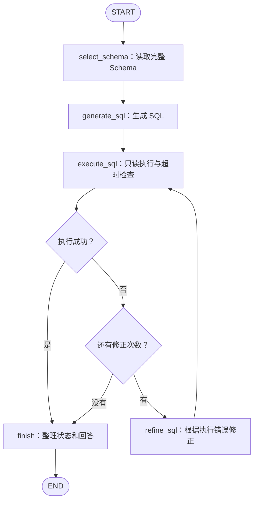

# 项目路线：第一阶段已完成，下一阶段进入业务口径 RAG

更新日期：2026-10-25（阶段 A 完成事实仍截至 2026-10-19）。

**第一阶段：LangGraph SQL 查询工作流，已按调整后的范围完成。**

当前实现位于 `MAC_with_LangGraph/`。后续从已有查询能力继续扩展，下一阶段为业务口径 RAG。本文记录当前进度与后续路线；原始规划可以从 Git 历史查看。

## 1. 当前阶段状态

| 阶段 | 目标 | 状态 |
| --- | --- | --- |
| A：SQL 查询 MVP | 自然语言生成 SQL、只读查询、超时控制、有界修正、固定题集评测 | **已完成，2026-10-19 收尾** |
| B：Olist 知识与数据 RAG | 围绕订单、支付、配送与评价，提供引用问答和遵守口径的 SQL 查询 | **数据源与范围已确定，尚未实现** |
| C：模型自主选择工具 | 由模型选择文档检索、数据库查询或统计工具，读取反馈并决定是否继续 | 尚未开始 |
| D：会话与长期 Memory | 多聊天隔离、偏好、恢复与遗忘 | 尚未开始 |
| E：分析与图表 | 基于查询结果进行趋势、分组与贡献分析 | 尚未开始 |
| F：多聊天 Web 应用 | 聊天管理、流式回答、来源与数据展示 | 尚未开始 |

第一阶段完成标准以本次协作确定的范围为准。token 统计、完整节点日志、统一异常出口和逐节点流式打印已明确暂缓，不再作为进入下一阶段的前置要求。

## 2. 第一阶段已交付的内容

| 完成项 | 当前实现或证据 |
| --- | --- |
| 显式 State 和 LangGraph 节点、路由 | `state.py`、`nodes.py`、`graph.py` |
| 真实 Schema 与外键读取 | 已在 `concert_singer`、`pets_1` 验证；小数据库保留全部表列 |
| DeepSeek SQL 生成与修正 | `llm.py`；采用简化提示词，不宣称严格复现原 MAC-SQL 全部行为 |
| SQLite 只读查询 | `mode=ro` 连接；返回列名、完整结果与数据库错误，结束后关闭连接 |
| SQL 查询超时 | 每次查询约 5 秒，通过 SQLite 进度回调检查；超时沿用现有错误与修正流程 |
| 有界修正循环 | 默认 `max_retries=3`，首次生成后最多修正 3 次；每版修正 SQL 都重新执行 |
| 正常与边界行为验证 | 已进行本地离线核查，见第 4 节；不是独立的真实模型纠错评测 |
| 固定 30 题真实回归 | 2026-10-18：执行成功 30/30，结果匹配 29/30 |
| 正式回归入口 | 临时脚本已整理为 `MAC_with_LangGraph/regression.py` |
| 运行说明、流程图与依赖 | 根 `README.md`、`MAC_with_LangGraph/README.md`、`requirements.txt` |
| 完整单题演示 | `learning/LANGGRAPH_DEMO.txt`，包含 SQL、查询结果、状态和回答 |
| 仓库整理 | 删除无运行依赖的旧实现，归档学习笔记；清理提交已同步 GitHub |

### 已完成的里程碑

- [x] 图流程跑通，能够执行真实 SQLite 查询。
- [x] 接入真实 SQL 生成，问题和 Schema 传入模型，标准答案留在图外评测。
- [x] 实现并离线验证有界修正；支持合法空结果与 NULL，SQL 超时不会返回成功。
- [x] 完成固定 30 题回归，保留逐题结果、汇总与新旧差异分析。
- [x] 整理正式运行入口、依赖、使用说明、单题演示和项目目录。

以上勾选表示调整后阶段目标已经完成，不表示原规划中的所有工程增强项都已实现。

## 3. 当前实际流程与 State



| 字段 | 当前用途 | 主要写入位置 |
| --- | --- | --- |
| `question`、`db_id` | 自然语言问题、数据库标识 | 单题或回归入口 |
| `schema_text`、`foreign_keys` | 表结构与外键说明 | `select_schema` |
| `sql` | 当前候选 SQL | `generate_sql`、`refine_sql` |
| `execution` | 成功标记、列名、完整结果、SQL 错误信息 | `execute_sql` |
| `retry_count`、`max_retries` | 已完成的修正次数与允许的修正上限 | 入口、`refine_sql` |
| `status`、`answer` | 最终执行状态与模板回答 | `finish` |

`state.py` 中的顶层 `error` 字段目前仅预留，未用于统一异常路由。当前 SQL 错误保存在 `execution["error"]` 中。

当前实现约定：

- 修正节点返回新 SQL 时，修正计数增加，并清空上一版 `execution`。
- 首次 SQL 成功就直接结束；默认预算下最多执行 4 版 SQL。
- SQL 超时是每次查询的近似时限，不是整个图的总时限；修正后再次执行会重新计时。
- `succeeded` 仅表示 SQL 执行成功，语义是否正确由图外评测判断。
- 单题运行的模型调用异常直接抛出，由运行者排查 API Key、网络、额度或模型配置；Schema 等未捕获异常也可能直接中断。
- 批量回归入口会保留单题异常记录并继续处理后续题目，不把异常题记为成功。
- 原始 Spider 的 `question` 是自然语言，`query` 是标准 SQL；标准 SQL 和标准结果不进入生成节点。

## 4. 评测结果与验证边界

### 采用的真实模型评测

只采用 **2026-10-18** 的完整评测记录作为第一阶段结果：

```text
outputs/langgraph_30_20261018_175344_798075/
├── results.jsonl
├── summary.json
└── report.md
```

题集为 `data/spider/macsql_30.json`，包含 `concert_singer` 21 题和 `pets_1` 9 题。

| 方法 | 执行成功 | 结果匹配 | 匹配率 |
| --- | --- | --- | --- |
| 历史 Baseline | 30/30 | 25/30 | 83.3% |
| 历史 DIN-SQL | 30/30 | 27/30 | 90.0% |
| 历史 MAC-SQL | 30/30 | 28/30 | 93.3% |
| LangGraph 工作流 | 30/30 | 29/30 | 96.7% |

LangGraph 本轮共 30 次模型调用尝试，各题图运行耗时累计约 23.85 秒；每题均首次执行成功，未触发真实模型修正。旧方法使用已保存的预测重新执行，并未重新调用旧模型生成答案。

相对历史 MAC-SQL，第 18、27 题变为匹配，第 28 题变为不匹配。第 28 题遗漏 `DISTINCT`，导致拥有多只宠物的学生重复出现；第 18、27 题的标准结果需要保留重复行，因此不能统一给所有 SQL 添加 `DISTINCT`。

比较完整执行结果：有 Gold 顶层 `orderBy` 时比较行顺序，否则使用 `Counter` 忽略行顺序但保留重复次数；列顺序固定，不要求 SQL 文本或列别名完全相同。当前按结果值直接比较，没有额外浮点容差规则。

### 已做的离线验证

- 使用模拟模型核查首次成功、修正后成功、最后一次修正成功、预算耗尽停止等控制路径。
- 在真实只读 SQLite 上核查普通查询、空结果、NULL、普通 SQL 错误和约 5 秒超时中断。
- 确认超时后仍按修正预算路由，后续查询可正常执行。
- 仓库清理后验证图可运行、两个数据库可读取，历史预测重算仍为 25/30、27/30、28/30。

这些是开发过程中的离线检查，尚未整理成仓库内的自动化测试套件或完整逐节点轨迹。它们不计入 30 题真实模型成绩，也不能证明真实模型的纠错准确率。

### 结果解释

- 30 题是固定开发／回归集，不是独立测试集，也不是 Spider 全量成绩。
- 提示词、Schema 格式和潜在模型版本差异共同影响结果，不能将成绩变化单独归因于 LangGraph。
- 29/30 的真实评测早于新增查询超时；超时改动已单独离线验证，没有为此重新跑完整模型回归。
- 当前不要求达到 30/30，也不要求为阶段收尾反复调用模型。

## 5. 明确暂缓的事项

以下内容未实现或未完整整理，已从第一阶段交付要求中移出：

| 事项 | 当前决定 |
| --- | --- |
| token 用量与费用统计 | 暂缓；工具调用跑通后，若需比较开销再记录模型响应中的用量 |
| 图内统一异常出口 | 暂缓；模型调用异常直接抛出，批量入口记录单题失败 |
| 完整节点日志、每版 SQL 轨迹 | 暂缓；保留当前逐题最终结果、汇总和演示输出 |
| 逐节点流式打印 | 暂不增加，继续使用 `graph.invoke()` |
| 模型筛选 Schema、复杂任务分解 | 当前小数据库不作为必要项 |
| 语义验证节点 | 暂缓；语义错误通过离线评测和人工分析定位 |
| 更多执行错误分类与结果展示优化 | 按后续实际需求补充，当前沿用现有执行错误结构 |
| UI、部署、人工介入与长期记忆 | 后续有明确场景时再做 |

这些决定不影响阶段 B 开始；后续只针对实际需求增加能力。

## 6. 当前目录、环境和运行入口

```text
MAC-SQL/
├── MAC_with_LangGraph/
│   ├── state.py
│   ├── nodes.py
│   ├── graph.py                 单题入口
│   ├── llm.py
│   ├── regression.py            固定 30 题回归入口
│   └── README.md
├── data/                        本地题集与数据库
├── outputs/                     本地实验结果
├── learning/
│   ├── LANGGRAPH_DEMO.txt
│   └── archive/macsql/          旧阶段学习记录
├── requirements.txt
├── README.md
└── NEXT_STEP_LANGGRAPH_PROJECT.md
```

已验证：Python 3.12.14、LangGraph 1.2.15、langchain-deepseek 1.1.1。当前 `requirements.txt` 已记录 LangGraph 依赖；原 Python 3.14 `.venv` 已清理，已验证的 Academy 环境仍可使用。

默认配置：`deepseek-flash`、temperature=0、max_tokens=1024、API timeout=60 秒、SDK max_retries=0、思考模式关闭。模型名称可通过 `DEEPSEEK_MODEL` 配置；API Key 从环境变量读取或由入口提示隐藏输入。

在项目根目录，使用安装好依赖的 Python 环境：

```bash
# 单题演示
python -m MAC_with_LangGraph.graph

# 查看回归参数，不调用模型
python -m MAC_with_LangGraph.regression --help

# 完整 30 题，调用真实模型
python -m MAC_with_LangGraph.regression

# 只重算历史 Baseline、DIN-SQL 和 MAC-SQL，不调用模型
python -m MAC_with_LangGraph.regression --offline-only
```

单题问题和数据库在 `graph.py` 的 `initial_state` 中设置。完整回归仍需同级目录 `din-sql/results/` 的历史预测及 `outputs/macsql_30/results.jsonl`。数据库、输出和个人进度笔记保留在本地，不随 Git 上传。

相关资料：

- [安装与项目首页](README.md)
- [详细运行说明](MAC_with_LangGraph/README.md)
- [单题演示](learning/LANGGRAPH_DEMO.txt)
- [旧 MAC-SQL 学习归档](learning/archive/macsql/README.md)
- 本地历史记录：`learning/LANGGRAPH_PROGRESS_2026-10-18.md`；其中“下一步”是当日记录，当前计划以本文为准。
- [清理前旧源码](https://github.com/imliumingzhe6150/MAC-SQL/tree/1ad71be68fbf8a9545a2fedf1fef4c18bea002e2)；当前运行不依赖这些旧文件。

## 7. 第二阶段：基于 Olist 的知识与数据 RAG

**业务范围已确定：采用 Olist 公开历史数据，围绕订单、支付、配送与评价，完成独立知识问答和知识与 SQL 联合回答。** 当前只完成范围设计，尚未下载或导入业务数据，也未实现 RAG。

场景说明见 [`docs/OLIST_SCENARIO.md`](docs/OLIST_SCENARIO.md)，完整范围、技术要求与验收以 [`STAGE_B_RAG_DETAILED_PLAN.md`](STAGE_B_RAG_DETAILED_PLAN.md) 为准。阶段 A 的历史结果与原 Spider 30 题仍独立保留。

### 起步范围

从 [Olist 官方数据集](https://www.kaggle.com/datasets/olistbr/brazilian-ecommerce)抽取订单及完整关联记录，使用订单项、支付、配送字段、评价和客户/商品/卖家维度。项目分析口径由我们明确编写，不能冒充 Olist 官方规则。

支持订单数与状态、支付记录金额与支付方式、交付时长与延迟率、订单评分与评价覆盖。真实退款、扣退款净成交额、利润、库存和渠道活动分析不在范围内；取消状态不能当作退款成功，静态快照不能当作实时或完整历史状态流水。

第一份指标契约为“按下单订单群计算的已交付订单延迟率”。例如：“按 v1 口径比较 2018 年 1 月下单订单在客户州 SP、RJ 的延迟率”，需要明确已交付状态、日期粒度、缺失值排除和有效分母，再生成 SQL。

### 推进顺序

1. **获取并剖析数据。** 登记来源、许可、版本和哈希，检查字段、状态、时间覆盖与关联基数，编写数据字典。
2. **冻结口径。** 先完成延迟率契约，再分别明确配送时长、商品金额、支付记录金额、取消率及评分口径。规则版本和数据快照分开管理。
3. **准备资料与评测。** 写 12～20 份有来源或标明自建的知识文档，抽取 30～50 笔订单及关联记录，标注 20 道开发题；独立计算标准结果，标准答案不入知识索引。
4. **跑通普通 RAG。** 实现导入、来源映射、Dense 检索、引用回答和 CLI。文档问题独立回答，不强制经过 SQL。
5. **逐步增强与联合查数。** 按 B1～B6 推进结构分块、版本生命周期、BM25 + RRF、重排对照、证据检查与 SQL 适配；首次生成和修正均保留契约。

### 最小验收与后续交付

- [ ] 场景、数据字典、指标契约、小样本和参考题彼此一致，数据能追溯到 Olist 快照。
- [ ] 文档问答能引用真实条款，联合问题能展示口径、SQL、结果和快照。
- [ ] 多表关联不重复计算金额或订单，数值有独立复算依据。
- [ ] 缺失退款数据、口径冲突、缺条件、空结果和分母为零能分别处理。
- [ ] 按详细计划完成检索对照、专题实验、冻结测试及可复现交付。

这一阶段由程序安排工作流；模型自主选择工具留到 C。普通 Dense 闭环是起点，混合检索与重排实验仍属于 B 完整交付。原 30 题不用于证明业务 RAG 效果；共用 SQL 逻辑发生变化时，按影响范围运行回归。

**下一步：获取 Olist 固定快照、完成字段与质量剖析，然后落地数据字典和延迟率契约。**

## 8. 第二阶段之后

| 阶段 | 具体增加什么 | 主要检查什么 |
| --- | --- | --- |
| C：工具选择 | 提供工具描述，由模型决定调用检索、查询或统计工具 | 工具选择、参数、反馈处理和停止条件 |
| D：会话与长期 Memory | 会话恢复、跨聊天偏好、记忆更新和删除 | 隔离、持久化、遗忘与缓存失效 |
| E：分析与图表 | 对查询结果做趋势、分组与描述性关联分析 | 数字可复算、图表有依据、相关不冒充因果 |
| F：多聊天对话式 Web 应用 | 聊天管理、流式回答、来源/数据/图表展示 | 历史恢复、停止重试、上下文隔离与完整用户流程 |

程序固定调用 `execute_sql` 不等于模型自主 tool calling；直接读取 Schema 也不等于完整业务 RAG。项目说明和简历只写已完成能力。

课程按项目需要穿插：Module 1、2 用于巩固当前图和 State；需要流式或人工介入时看 Module 3；组合多个模块时看 Module 4；有跨会话记忆和部署需求后再看 Module 5、6。无需先学完所有课程再继续开发。

第一阶段现阶段可以据实描述为：“参考 MAC-SQL 角色职责实现 LangGraph SQL 查询工作流，完成只读执行、查询超时、有界修正和固定 30 题回归，保存逐题结果及单题演示。”后续实习或科研材料中的结果、能力和限制均以实际记录为依据。
