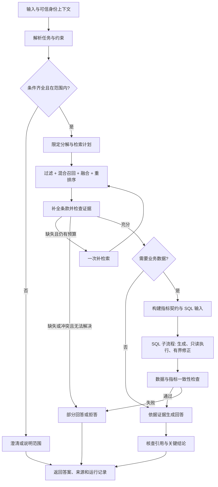

# B 阶段详细规划：基于 Olist 的订单、支付、配送与评价助手

更新：2026-10-25。状态：**设计与实施要求，尚未实现**。

本文件细化 `NEXT_STEP_LANGGRAPH_PROJECT.md` 的阶段 B 与后续路线。总路线保留阶段 A 的历史事实；本文用于下一阶段的设计与验收，不代表已经完成其中的能力。本文中的数据量、预算、阈值均为项目建议，必须在实际实验中记录结果。

## 1. 项目定位：让知识检索成为独立能力

项目定位为 **RetailOps Copilot：基于 Olist 的订单、支付、配送与评价助手**。目标用户是运营分析人员和业务负责人，帮助他们查阅数据说明与分析口径，核对订单、支付记录、配送表现和客户评价。2026-10-25 已确定采用 Olist 公开数据；数据导入与业务功能尚未实现。一页场景说明见 [`docs/OLIST_SCENARIO.md`](docs/OLIST_SCENARIO.md)。

**最终产品形态已确定：一个支持多个独立聊天的对话式 Web 应用。** 用户通过左侧聊天列表创建、切换和管理聊天，在主区域连续提问、接收流式回答，并查看引用、数据表和图表。B 阶段先完成底层能力，最终交付必须包含这个聊天界面；详见第 12.4 节。

原来的 B 阶段只要求“检索业务口径 → 生成 SQL”。新的 B 阶段要同时完成三类任务：

1. **知识任务**：回答字段含义、指标定义、分析流程和例外条件；比较项目口径版本；组合多份文档形成有引用的分析建议。
2. **数据任务**：从实际数据库读取结果，用明确的指标定义解释数字，能复算。
3. **联合任务**：先确认业务规则，再查数，最后把文档证据、数据事实和待验证的判断分开表达。

例如，“已交付订单延迟率如何定义？”不需要 SQL；“订单支付金额与商品金额为什么可能不同？”需要结合支付、订单项及金额口径文档；“按项目 v1 口径比较 2018 年 1 月下单订单在不同客户州的延迟率”需要文档和 SQL 联合回答。

项目质量体现在：遇到真实复杂性时仍然能给出可检查的答案；能够测出改进和退化；更新文档后行为可预测。数据库品牌、文档数量、Agent 数量本身不能证明这些能力。

### B 阶段的范围分级

| 层级                 | 本阶段要求                                                                                                                                                            |
| -------------------- | --------------------------------------------------------------------------------------------------------------------------------------------------------------------- |
| 必做主线             | 可更新知识库、文档版本与来源、结构分块、Dense + BM25 混合召回、RRF、重排序对照实验、限定范围的查询分解、证据检查与有界补检索、引用回答、知识与 SQL 联合流程、分层评测 |
| 至少完成一个专题实验 | Multi-query、父子块/多表示检索、Step-back、HyDE 中任选一个，针对实际失败样本设计实验；允许最终结论是不用                                                              |
| 后续增强             | RAPTOR、ColBERT、复杂表格/OCR、外部网页检索、规模化检索服务                                                                                                           |
| 留到后续阶段         | 自主 Tool Calling 循环、Redis 跨会话 Memory、复杂归因与图表、正式 Web 产品化                                                                                          |

重排序必须接入并评测，但是否默认启用由质量与延迟共同决定。高级方法必须有失败案例、基线和结果，不能只在架构图上列名称。

## 2. 业务场景与代表任务

已选择 [Olist 官方公开数据集](https://www.kaggle.com/datasets/olistbr/brazilian-ecommerce)：约 10 万笔、2016—2018 年的巴西电商历史订单及关联数据。实际日期范围、表行数和质量以下载后的固定快照核验为准。项目使用真实公开记录，分析规范和处理流程由项目编写；不能将自建规范称为 Olist 官方制度，也不把其他平台规则套在这些历史订单上。

### 2.1 四类可交付任务

| 任务                | 示例                                                                        | 必要证据与完成条件                                               |
| ------------------- | --------------------------------------------------------------------------- | ---------------------------------------------------------------- |
| 单文档知识问答      | “已交付订单延迟率的分母是什么？缺失交付日期怎么办？”                      | 引用项目指标契约中的对象、公式和排除规则                         |
| 跨文档比较/流程回答 | “分析支付金额与商品金额差异时，应检查哪些表和关联关系？”                  | 结合支付、订单项、运费及数据质量说明，给出检查顺序               |
| 版本与口径解释      | “项目延迟率 v1 与 v2 的日期判断规则有什么不同？按 v1 解释。”              | 引用项目版本与变化条款；不冒充 Olist 历史政策变更                |
| 知识与数据联合      | “按 v1 口径，比较 2018 年 1 月下单订单在不同客户州的延迟率和有效样本量。” | 找到契约与字段说明 → 只读 SQL → 程序计算 → 数字和规则分别引用 |

至少一半正式评测问题不依赖 SQL，以保证 RAG 是独立产品能力。联合问题也不能退化为给 SQL 提示词多拼一段文本。

### 2.2 五个完整演示故事

1. **新同事查口径**：查询延迟、低评分或取消订单的定义，展开引用查看条件与例外。
2. **运营比较口径**：比较订单商品金额、运费与支付记录金额，结合字段文档解释为何不能直接互换。
3. **指定版本查数**：按指定项目口径查询历史订单，展示规则版本、SQL、结果、样本量和数据快照。
4. **证据不足**：询问真实退款金额、利润或实时订单状态；指出缺少退款流水、成本或实时数据，不能用取消状态或支付金额替代。
5. **规则更新**：导入项目规范新版本后，当前规则问题使用新版本，显式旧版本问题仍能引用旧规范；删除文档后检索与缓存同步失效。

最终演示包含成功和失败处理。不能只演示事先挑好的三个成功问题。

### 2.3 支持范围与明确边界

- **订单**：订单数、状态分布、取消订单占比；按下单时间、客户州等分组。客户复购分析用 `customer_unique_id`，不把每单分配的 `customer_id` 当成跨订单客户身份。
- **支付**：支付记录金额、支付方式、分期字段分布。支付记录金额不直接等于净成交额、到账收入或利润；一笔订单可有多条支付记录，订单数和金额分别定义粒度。
- **配送**：已交付订单延迟率、下单至交付时长、实际与预计交付日期差；区分客户州与卖家州。订单级配送结果不能直接归责于一个卖家。
- **评价**：订单评分、低评分订单占比、评价覆盖率，以及配送表现与评分的描述性关联。先明确多条评价的选择/聚合规则；没有评价不能记为 0 分，关联不能当作因果。
- **维度**：客户州、卖家、商品类别、支付方式等，以实际字段为准。多卖家、多类别订单不天然属于唯一分组，必须给出归属或分摊规则；首版延迟率按客户州分组。
- **不支持**：真实退款金额/成功率/到账时间、扣退款后的净成交额、利润、库存、优惠活动效果、官网/平台店/直播渠道比较，以及任意历史时点的完整状态重建。取消不等于退款成功；卖家、支付方式都不是渠道。
- 保留退款问题作为能力边界评测，不新增合成退款、渠道或活动表来扩展主线。退款政策只有库中存在适用且来源明确的规则才可回答；首版不承诺 Olist 真实退款政策问答。

## 3. 数据与知识库建设

### 3.1 两套数据分别承担不同职责

- **原 Spider 数据和固定 30 题**：保留为 SQL 回归资产，不用于证明新业务 RAG 的效果。
- **新增 retail_ops 业务集**：使用 Olist 固定快照、数据说明、项目分析规范和评测标注，与原题集及结果分开。保留目录名 `retail_ops`，数据来源登记为 Olist。

建议分两步准备：

| 时点           | 文档                                              | 业务数据                                          | 用途                                             |
| -------------- | ------------------------------------------------- | ------------------------------------------------- | ------------------------------------------------ |
| 首个纵向闭环   | 12～20 份有实质内容的文档                         | 从 Olist 分层抽取 30～50 笔订单，保留完整关联记录 | 验证来源、关联粒度、引用、计算和错误处理         |
| B 阶段完整交付 | 60～100 份为上限参考，不凑数拆文档；覆盖至少 5 类 | 先固定 1～5 万笔订单子集，需要时扩到公开全量      | 覆盖不同状态、时间、地区和关联基数；记录本机耗时 |

小样本按订单 ID 抽取，不随机截取 CSV 前 50 行。保留选中订单的全部订单项、支付、评价与所需维度行，记录抽样种子、条件、订单清单及文件哈希。日期覆盖和完整月份在数据剖析后确认；起止附近不完整月份不默认参与月度比较。

真实数据未覆盖的边界可另建极小合成测试夹具，存放在测试目录并标记 `synthetic_fixture`；不得改写原始记录，也不混入真实经营统计。保留来源 URL、下载日期、数据集版本、许可信息及处理脚本。当前只确定数据源，尚未下载、抽样或核验实际数据。文档与数据规模不用于宣称“生产级”。

### 3.2 文档类型

| 类型               | 内容                                                       | 必须包含的难点                                 |
| ------------------ | ---------------------------------------------------------- | ---------------------------------------------- |
| 指标字典           | 延迟率、配送时长、商品金额、支付记录金额、取消率、低评分率 | 粒度、分子分母、时间字段、排除项、单位         |
| Schema/字段说明    | 订单、订单项、支付、客户、卖家、商品与评价                 | 类似字段名、不同时间含义、一对多关系、客户身份 |
| 分析 SOP           | 配送异常、金额差异、缺失评价的核查流程                     | 检查顺序、适用对象、结论边界；标为项目自建流程 |
| 数据质量与范围说明 | 缺失时间、异常顺序、多支付、多评价、快照限制               | 清洗规则、例外、地区/类别归属、缺失不等于零    |
| FAQ/案例与版本说明 | 常见误算、口径变化、分析案例                               | 案例不覆盖规范；项目版本不冒充企业历史政策     |

文档来源分清：Olist 官方数据卡/字段说明、基于实际数据剖析的观察、项目制定的分析规范。公开参考材料记录 URL 和访问日期；自建文档标注 `project_defined`，数据剖析结论关联快照及检查结果。外部参考没有适用依据时不能升级为 Olist 业务事实。

首批文档可覆盖数据来源与边界、表关系、订单状态与时间、订单项与运费、支付、客户与地区、商品与卖家、评价、延迟率、配送时长、金额口径、取消率、评分口径、异常排查、FAQ 和项目版本演示。准备相近指标、草稿等干扰材料；不写成题目与标准答案配对。版本演示中的冲突标为测试用途，正常默认知识快照不混入未解决冲突。

首版输入限定为 Markdown 和可解析的结构化文本；PDF/OCR 不作为 B 阶段前置依赖。后续增加 PDF 时，再补页码、版面与表格解析质量评测。

### 3.3 业务数据库与关键约束

以下为规划的本地表名，映射 Olist 同名主题 CSV；最终列名、枚举和约束须导入前核验：

- `orders`：订单、客户、状态、下单、支付批准、交运、实际交付和预计交付时间。
- `order_items`：订单项序号、商品、卖家、商品金额和运费；主键候选为 `(order_id, order_item_id)`，先检查再建立约束。
- `order_payments`：支付序号、方式、分期数和金额；先核验 `(order_id, payment_sequential)` 唯一性。
- `order_reviews`：评价 ID、订单、评分、文本与相关时间；不先验假定每单一条评价或评价 ID 唯一。
- `customers`、`sellers`、`products`、`product_category_name_translation`：客户身份与地区、卖家、商品类别及类别翻译。
- `geolocation`：需要地理分析时再加入；邮编前缀不能直接假定唯一，先聚合后关联。

**金额与时间：**保留原始 CSV；金额使用巴西雷亚尔（BRL），分析层通过十进制解析转整数分，不能标成人民币。支付批准时间不等于逐笔支付事件/到账时间，分期数不用于再次乘算支付金额。原始时间若没有时区偏移，则保留为源时间语义、登记时区未确认，不自动套用 `Asia/Shanghai`、UTC 或某个巴西时区。统计日期按源记录日历值处理；日期区间用半开区间 `[start, end)`。

**关联与质量：**订单项、支付和评价先分别处理到目标粒度再 JOIN，防止多对多放大金额和订单数。跨类别/卖家汇总若不具有可加性，要在答案中说明。检查主键候选、外键缺失、空值、状态枚举、时间顺序和重复行；金额对账记录差异与解释，不强制把公开数据改成“商品金额 + 运费一定等于支付金额”。保留清洗前后计数及排除原因。

小样本尽量覆盖已交付准时/延迟订单、取消/未交付订单、多订单项、多支付、多评价或缺失评价、缺失时间、跨月下单和交付。空结果、分母为零、重复关联和版本边界用查询条件或独立夹具补充。不能把未交付订单视作准时订单，也不能从取消状态推断未支付或已退款。

### 3.4 第一份指标契约：已交付订单延迟率

以下是**项目 v1 分析约定**，待导入核验后在 B0 冻结为版本化文档，不声称是 Olist 官方 KPI：

```yaml
metric_id: delivered_order_late_rate
version: 1
label: 按下单订单群计算的已交付订单延迟率
rule_origin: project_defined
grain: order
cohort_time: orders.order_purchase_timestamp
timezone: source_naive_unverified
comparison_granularity: calendar_date
required_inputs: [period_start, period_end, customer_state_scope, db_snapshot, metric_version]
definition:
  eligible: 统计期内下单、快照状态为 delivered、实际及预计交付时间均有效的订单
  late: eligible 中实际交付日期晚于预计交付日期的订单
  rate: late_order_count / eligible_order_count
exclusions: [未交付订单, 缺失或无法解析的必要时间, 实际或预计交付时间早于下单时间]
zero_denominator: null_with_reason
output: [late_order_count, eligible_order_count, excluded_order_count, rate]
rounding: 展示百分比保留两位小数；评测使用原始计数和未舍入比值，容差在 B0 登记
source_ref: metrics/delivered_order_late_rate_v1.md#definition
```

同一天交付在 v1 中不算延迟，即使实际时间晚于预计日期的零点；排除订单数统计所选时间/客户州范围内不满足 eligible 的订单，缺失下单时间而无法归期的行另列全局质量计数。统计期、客户州范围和版本必须明确，全部客户州可作为显式登记的默认范围。

后续分别登记配送时长（下单到交付或交运到交付不可混用）、已交付订单商品金额（不含运费、不扣未知退款）、支付记录金额、取消订单占比、订单平均评分/低评分率与评价覆盖率。低评分阈值、多评价处理、缺失值、分母及状态过滤都必须写入对应契约。首版不将支付记录称为完整现金流水，也不把支付记录金额按商品类别随意分配。

**版本与快照分开：**`policy_as_of` 保留为项目规则适用时点，可由显式 `metric_version` 解析；项目规范可在 2026 年定义并用于分析 2017—2018 年订单，不能按订单日期误选成不存在的规则。文档的 `effective_from/to` 是项目规则版本的适用区间，数据适用范围另存 `data_period_scope`。版本变更演示使用明确标记的项目版本；跨版本请求按契约分段或澄清。

`db_snapshot` 标识固定数据文件及哈希；`data_as_of` 若无法从来源确认观察截止时点，则为 `null` 并说明未知。下载时间、最大订单日期和历史统计期不能冒充快照观察截止时点。首版仅回答“按固定快照看到的历史订单结果”，不声称重建“截至过去某天当时已知的订单状态”。

## 4. 文档生命周期：可追溯、可更新、可撤回

### 4.1 来源与版本契约

文档至少保存以下字段；字段进入检索前需要校验：

| 字段                                                             | 含义                                                         |
| ---------------------------------------------------------------- | ------------------------------------------------------------ |
| `doc_id`、`version`                                          | 稳定业务身份与不可变修订版本                                 |
| `title`、`doc_type`、`source_uri`                          | 标题、类型、原文位置                                         |
| `origin_type`、`source_accessed_at`                          | 官方资料/数据剖析/项目自建/测试夹具；外部来源访问日期        |
| `content_hash`、`ingested_at`                                | 内容校验与导入时间                                           |
| `effective_from`、`effective_to`                             | 业务有效期，结束点不包含；无上界使用明确约定                 |
| `published_at`、`status`                                     | 发布时间与草稿/已发布/撤回状态                               |
| `authority`                                                    | 正式分析规范、指标规范、案例、FAQ 等等级；规则由项目显式定义 |
| `applicable_scope`、`business_domain`、`data_period_scope` | 适用对象（如订单状态、客户州）、业务域与数据期间             |
| `tenant_id`、`access_scope`                                  | 数据隔离和访问范围，首版使用可控的演示身份                   |

chunk 另外保存 `chunk_id`、`parent_id`、章节路径、字符位置或稳定锚点、原文摘录和所用切块版本。`chunk_id` 可由文档 ID、修订版、章节、序号及切块配置派生；不要仅按正文去重而丢掉不同来源和权限。

项目需要区分“旧版本不再用于当前查询”和“文档撤回后不可再提供”。旧版本仍可用于合法历史查询；撤回或删除文档应按项目保留规则退出可检索集合，历史运行记录只保留允许保留的审计信息。

### 4.2 索引流程

```text
读取源文件 → 解析元数据 → 校验规则与版本 → 结构化分块
→ 构建父块/子块和来源映射 → 生成向量 → 更新关键词与向量索引
→ 完整性检查 → 发布 index_version → 记录 manifest
```

必须实现：

1. **幂等导入**：同一内容重复导入不产生重复 chunk；不重复调用 embedding。
2. **增量更新**：仅重新处理变化的文档，移除失效块；关键词索引和向量索引保持同一版本。
3. **删除传播**：源文档删除/撤回后，子块、父块映射和相关缓存一起失效。
4. **失败不破坏当前索引**：发布新 manifest 前完成检查，失败批次不成为线上默认版本。首版允许单进程写入和构建期间暂停查询，但必须检测并拒绝混用版本。
5. **可复现重建**：记录文档快照、分块策略、embedding 模型/维度、索引配置、依赖锁定信息。

导入结果要显示新增、修改、跳过、删除和失败文档数；解析错误不能静默吞掉。更新 embedding 模型或维度时新建索引版本，不混用新旧向量。

## 5. 检索架构与课程内容的对应

### 5.1 默认技术路径

```text
用户问题
→ 意图与约束解析（任务、客户州/类别等维度、时间、指标、必需条件）
→ 硬过滤（身份权限、文档状态、版本范围）
→ 每个子问题进行 BM25 + Dense 召回
→ RRF 融合、去重
→ Reranker 重排序
→ 必要的父块/例外条款补全
→ 上下文预算与证据覆盖检查
→ 有据回答 / 只读查数 / 一次补检索 / 澄清或拒答
```

初始调试配置：BM25、Dense 各召回 20 条，每个子问题融合后保留 20～30 条，重排序保留约 6～8 条；最多 3 个子问题，合并后候选池上限 60 条。最终证据上下文预算从约 6,000 tokens 开始，超过预算按子问题覆盖和权威性压缩选择。数字是起始参数，最终配置由开发集确定。

如果子问题证据不能在预算内完整覆盖，返回部分回答或缩小问题，不静默丢掉一个子问题。示例中 RRF 平滑参数初始取 60，并写进配置；不同库的默认值未必相同。

### 5.2 分块策略

- 以标题、条款、列表和指标定义为边界，保留文档标题与章节路径。
- 子块初始约 300～600 tokens，父块约 1,000～1,800 tokens；以 tokenizer 或明确的近似策略计量，不能将中文字符数直接当作模型 token 用量。
- 指标公式、分子分母、适用范围尽量保持在同一语义单元；指标条件和例外应同块或通过结构链接补全。
- 表格转文本时重复必要列头、保留单位与标题，不仅检索孤立的一个数字。
- 父块回填后重新检查权限、版本与总长度。父文档太长时回填相关章节，不整篇塞入。

比较“固定长度块”与“结构块”，记录证据覆盖率、误召回和上下文长度。不要凭一个漂亮问答判断最优 chunk size。

### 5.3 混合检索、融合与重排序

BM25 负责商品编码、指标名、状态枚举和精确词；Dense 负责同义表达和自然语言描述。中文 BM25 必须明确分词及领域词典方案，避免按空格切中文；订单编码、SKU 和英文缩写应保留完整形式。

两路检索使用相同的权限、时间及范围约束。BM25 应在允许集合内计分/选 top-k，不能全库取 top-k 后才过滤导致候选不足。Dense 使用元数据过滤；Chroma 的 `where` 可约束检索记录，复杂业务条件由应用层先解析并校验。[Chroma 官方文档](https://docs.trychroma.com/docs/querying-collections/metadata-filtering)

RRF 根据排名融合，不直接相加 BM25 分数与向量相似度。重排序是在候选集合上重新评估问题与文本的相关性，两者职责不同。可参考 [Qdrant 的融合说明](https://qdrant.tech/documentation/search/hybrid-queries/)，但本阶段不要求迁移到 Qdrant。

延续本地教程，首选尝试现有百炼重排序配置，保留 `qwen3-rerank` 等模型名为配置项；服务调用须按对应重排序接口实现，不能当聊天接口使用。当前可用模型和限制以[百炼官方接口](https://help.aliyun.com/zh/model-studio/text-rerank-api)为准。其分数只用于排序，不能当作答案正确率或跨模型通用拒答阈值。

### 5.4 对照 rag-from-scratch 的技术取舍

| 本地课程位置             | 技术                              | 在本项目中的要求                                                                    |
| ------------------------ | --------------------------------- | ----------------------------------------------------------------------------------- |
| `1_to_4`               | Indexing / Retrieval / Generation | 必做可复现基线；从 notebook 提炼为模块，分离离线索引和在线问答                      |
| `5_to_9` Part 5        | Multi-query                       | 扩展实验：原问题 + 最多 2 个改写；保留地区/类别、日期、否定词和指标约束             |
| `5_to_9` Part 6        | RAG-Fusion                        | 必做 RRF；先用于 BM25 与 Dense，多查询融合另做消融，避免混淆收益来源                |
| `5_to_9` Part 7        | Decomposition                     | 必做限定范围分解：比较/多规则任务最多 3 个子问题，各有证据和完成状态                |
| `5_to_9` Part 8        | Step-back                         | 当细节问题缺少上位概念时实验；抽象查询不能替代原问题条件                            |
| `5_to_9` Part 9        | HyDE                              | 选做；生成文本只能用于检索，绝不能作为答案证据或入库事实                            |
| `10_and_11` Part 10    | Logical / Semantic Routing        | 必做结构化逻辑路由；语义路由作为对照，不用嵌入相似度决定权限                        |
| `10_and_11` Part 11    | Query Structuring                 | 必做时间、地区/类别、文档类型、指标的结构化约束；权限来自可信上下文                 |
| `12_to_14` Part 12     | Multi-representation              | 可选重点专题：摘要/问题向量定位原文，引用仍指向真实原文；父子块作为相关设计单独评测 |
| `12_to_14` Part 13     | RAPTOR                            | 有长文档全局总结需求、普通检索确实遗漏跨章节信息后再实验                            |
| `14_colbert` / Part 14 | ColBERT                           | 资源与领域匹配实验，比较效果、索引大小、时延；不强行合并其独立旧依赖环境            |
| `15_to_18` Part 15     | Re-ranking                        | 接入、测量；重点分析召回正确而前排错误的样本                                        |
| `15_to_18` Part 16     | CRAG 思路                         | 必做简化的证据检查与一次补检索；不能声称完整复现 CRAG                               |
| `15_to_18` Part 17     | Self-RAG 思路                     | 检查答案是否被证据支持；一般提示词自评不等同论文训练方法                            |
| `15_to_18` Part 18     | Long Context                      | 小型对照：增加上下文是否带来噪声、成本和正确率变化                                  |

本地 Part 13、16、17、18 部分只提供外部材料链接，并无完整可执行实现；用户已学过这些内容，但项目落地仍需独立设计。Part 12、15 的国内接口适配以及 ColBERT 独立环境可复用经验，不直接复制全部 notebook 环境。

## 6. 查询理解、冲突处理与证据决策

### 6.1 查询计划

路由输出受 schema 约束的对象，至少包括：

```text
intent: knowledge | comparison | data | hybrid | clarify | out_of_scope
subquestions: [{id, question, required_evidence_types, depends_on}]
filters: {applicable_scope, business_domain, policy_as_of, doc_type}
metric_request: {metric_id, metric_version, period_start, period_end, db_snapshot, data_as_of, dimensions, dimension_filters}
missing_fields: [...]
```

限定意图、过滤字段和运算符；模型生成未知字段、无效日期或互相矛盾条件时，校验失败并澄清或有界修复。`tenant_id`、角色与访问集合从应用身份上下文注入，模型不得覆盖。

首版结构化路由可以使用模型的结构化输出，但后续执行路径由程序约束；这仍是工作流。自主 Agent 的区别在于能根据工具反馈动态决定后续步骤，参见 [LangGraph workflows and agents](https://docs.langchain.com/oss/python/langgraph/workflows-agents)。

### 6.2 版本与冲突规则

优先判断是否适用于用户要求的分析对象、项目规则版本和数据范围，再判断已发布状态与权威等级。只有满足适用条件的材料才能参与答案。

- 当前规则问题：取请求时点有效的版本；不能仅按最近上传时间。
- 历史项目规则问题：按显式 `metric_version` 或规则时点 `policy_as_of` 过滤；不从订单统计期推断版本。追溯文档当时是否已发布时再限制 `published_at`，这不等于恢复订单历史状态。
- 比较新旧规则：建立两个版本检索分支，分别引用；不能沿用仅保留当前版本的默认过滤器。
- 正式分析规范与案例冲突：正式分析规范约束回答，案例用于解释，不能覆盖规范。
- 同一范围、同一有效期内出现两个同等级矛盾规则：报告冲突和两份来源，停止依赖该规则的计算或建议。
- 没有来源明确的优先规则：不让模型凭语气或相似度选一个当真。

### 6.3 证据是否足够

证据检查返回结构化状态：`sufficient`、`missing`、`conflicting`、`outdated`，并列出缺少哪些条件。检查重点是问题需要的要素是否被覆盖，而非“前 5 条看起来相关”。

例如延迟率问题需要覆盖订单群、状态、日期比较粒度、客户州范围、排除项和分母；找到“延迟”关键词不代表已经找到答案。联合问题还需要完整指标契约。

补检索只允许一次：根据明确缺失项改写查询或补取相关条款；不能绕过权限、删除条件或改变历史日期来凑结果。第二轮仍不足就澄清、部分回答或拒答。B 阶段不自动转向互联网补齐项目规则。

检索/模型服务故障与“知识库确实无答案”分开表示。重排序失败可以降级为 RRF 排名并记录；embedding 故障可按策略降级为 BM25，但答案仍须通过证据检查。

## 7. LangGraph 集成与已有 SQL 能力的复用

### 7.1 建议图结构



引用核查失败时至多重写一次答案；仍不支持的关键结论删除并说明限制，必要时返回部分回答。补检索、答案重写和 SQL 修正分别计数，共同受请求总预算限制。

### 7.2 与当前代码的具体衔接

已核对 `MAC_with_LangGraph/state.py`、`nodes.py`、`graph.py`：目前生成与修正提示词只接收问题、Schema、外键及执行错误，数据库路径固定在 Spider 目录，最终成功主要代表 SQL 执行成功。

本阶段需要规划以下改动：

1. 新增业务入口和 State；通过适配层调用已有 SQL 流程，保留原 30 题入口。
2. 将数据库解析改为白名单配置映射，例如 `retail_ops → 明确的本地路径`。不能让模型传入任意文件路径或拼接用户输入访问数据库。
3. `generate_sql` 接收已校验的指标契约、来源 ID、时间/地区/状态约束和真实 Schema。
4. `refine_sql` 接收**同一份指标契约与约束**；修正语法不能丢掉订单状态、排除项、粒度或时间字段。
5. 区分 `execution.success`、`semantic_checks`、`evidence_status`；SQL 能执行不能自动升级为回答正确。
6. 新业务 `finish` 汇总证据、SQL 和结果；保留无证据、冲突、合法空结果、运行失败等不同状态。

保留已有只读连接、单次查询时限和有界修正。新业务入口补充单语句校验、表/列访问白名单、受限 SQLite authorizer 或等效执行策略；不能只靠提示词要求 SELECT。拒绝任意 ATTACH、文件/扩展访问等不在查询能力范围的操作。

SQL 返回采用结果大小上限与明确的 `truncated` 标记。业务指标尽量在数据库中聚合；展示截断不能悄悄改变汇总数字。所有实际执行过的 SQL 及错误要进入结构化轨迹，原 A 阶段已暂缓的详细终端流式展示仍不必补做。

### 7.3 State 与模块契约

| 对象       | 核心字段                                                                                   |
| ---------- | ------------------------------------------------------------------------------------------ |
| 请求上下文 | `request_id, tenant_id, user_id, roles, question, request_time`                          |
| 查询计划   | `intent, subquestions, filters, missing_fields, metric_request`                          |
| 检索记录   | `query_id, original_query, rewritten_queries, index_version, candidates, rank_details`   |
| 证据       | `evidence_id, doc_id, version, chunk_id, source_uri, locator, excerpt, applicable_scope` |
| 证据决策   | `status, required_items, covered_items, missing_items, conflicts`                        |
| SQL 结果   | `query_id, db_snapshot, sql, columns, rows_or_artifact, data_as_of, truncated, error`    |
| 回答       | `status, answer, claims, citations, limitations, clarification_question`                 |
| 运行预算   | `retrieval_attempts, answer_rewrites, sql_retries, model_calls, elapsed_ms`              |

`status` 建议使用 `answered / partially_answered / needs_clarification / insufficient_evidence / conflicting_evidence / failed`；不能统一用空字符串回答表示所有失败。

模块接口先按普通函数实现：`search_knowledge(request)`、`get_source(evidence_id)`、`run_readonly_query(query_request)`。返回稳定的结构化对象，为 C 阶段包装工具做准备。向量、完整索引和所有原始长文不放进 State；保留引用和本次必要证据。

## 8. 回答与证据的交付标准

### 8.1 文档答案

回答应包含直接结论、适用条件、例外/缺失项以及就近引用。引用展示为“文档标题 / 版本 / 章节”，能在 CLI 或来源文件中定位，不只是一个不可解释的 chunk ID。

建立 `claim → evidence_id` 映射。程序先验证引用 ID 属于本次合法检索集合、来源和版本存在、定位有效，再对关键结论检查原文是否真正支持。引用存在与引用支持是两个不同指标。

如果通过 LLM 做支持性判断，它只是辅助检查器；保留判定理由和人工抽检，不能让同一个模型“觉得自己没问题”成为唯一验收证据。

### 8.2 文档与 SQL 联合答案

建议输出格式：

```text
结论：<基于实际查询的结果>
范围：<统计期、客户州/类别等范围、单位、数据快照及已知或未知的观察截止时间>
采用口径：<指标名、版本、核心规则> [D1]
数据依据：<聚合结果表、query_id> [Q1]
解释：<哪些由数据直接支持，哪些仅是待验证假设>
限制：<缺失维度、截断、样本或版本限制>
可展开：文档原文、SQL、查询参数与运行时间
```

数值来源 `[Q1]` 与规则来源 `[D1]` 分开；业务文档本身不能证明“2018 年 1 月的延迟率是多少”。环比、占比等由程序或 SQL 计算，不由模型心算。回答“为什么下降”时，仅有聚合变化不足以证明因果；B 阶段可列出观察和排查步骤，深入归因留给后续分析阶段。

## 9. 评测：证明做对了什么，也知道哪里没做好

### 9.1 题集与防泄漏

建议建立 120 道业务题，60 道开发题 + 60 道冻结测试题；首个闭环先做 20 道开发题。问题覆盖以下构成，两个 split 各占一半：

| 题型               |          总数 | 核心考点                           |
| ------------------ | ------------: | ---------------------------------- |
| 单文档知识问答     |            24 | 条件、例外、引用                   |
| 跨文档比较与流程   |            24 | 多证据覆盖、分析对象与口径适用范围 |
| 版本与时间         |            18 | 历史规则、有效期边界               |
| 知识与 SQL 联合    |            24 | 口径、聚合粒度、可复算数字         |
| 缺证据/冲突/需澄清 |            18 | 正确停止、正确提问、部分回答       |
| 权限与文档注入     |            12 | 隔离、资料内容不能变成系统指令     |
| **合计**     | **120** | 其中 96 题以非 SQL 能力为主要考点  |

题目按任务家族划分，例如同一问题的改写、同一配送异常案例的数字替换不能分散到开发和测试两边。测试知识仍在可检索语料中；隐藏的是评测问题、标签、标准结果与证据标注，而不是要求系统回答不在知识库中的事实。

准备问题时可以借助模型，但须人工核对答案、证据范围和难度，确保题目不仅复制文档标题。测试集冻结后不按失败题逐条调整提示词再报告原测试分数；若用于调试，标明它已成为回归集，并另建未见题。

每题至少包含：`question_id, split, family_id, question, identity, expected_route, required_evidence_groups, expected_behavior, reference_facts`。联合题另有独立编写的参考 SQL/计算结果与固定数据快照。Gold 只进入评测器，不能进入运行图、索引或检索提示词。

### 9.2 分层指标及其口径

| 层次       | 指标与计算方式                                                                                                   |
| ---------- | ---------------------------------------------------------------------------------------------------------------- |
| 召回       | 必需证据组 Recall@k：召回覆盖的必需证据组 / 全部必需证据组；可互相替代的条款归为同一组，避免重复块抬分           |
| 排序       | 在子集上人工标 0/1/2 相关性，计算 nDCG@10；同时报告单证据题 MRR                                                  |
| 多证据     | 完整证据覆盖率：所有必需证据组均进入最终上下文的题数 / 此类可回答题数                                            |
| 答案       | 按固定 rubric 评直接正确、条件完整、无额外编造；LLM judge 辅助，人工复核抽样与全部严重失败                       |
| 引用       | 支持精确率 = 被引用证据实际支持的声明数 / 被引用声明数；引用完整率 = 有有效支持的应引用声明数 / 全部应引用声明数 |
| 联合任务   | 数值/结果正确率 + 指标契约遵从率，单独列 SQL 执行成功率，三者不混用                                              |
| 拒答与澄清 | 应停止题的行为正确率，以及可回答题的误拒答率；部分回答不能自动算全对                                             |
| 工程       | p50/p95 总耗时、检索/重排/模型分项耗时、调用次数、token、索引时间与大小、更新耗时                                |

Recall 按召回候选池和最终上下文分别报告。无正确证据的问题不计算 Recall，进入拒答/冲突指标。结果给出分子与分母，不能仅给百分比；测试样本有限，避免宣称统计显著性或普适提升。

### 9.3 初始验收目标

以下是**项目目标而非现有成绩**；B0 时登记，在开发集上确认合理性后冻结，不能看到测试结果再下调并伪装达标：

- 可回答题的必需证据组 Recall@10 ≥ 90%；多证据任务完整覆盖率 ≥ 80%。
- 答案正确率 ≥ 85%；引用支持精确率 ≥ 95%，引用完整率 ≥ 90%。
- 联合题数值/结果匹配率 ≥ 90%，关键指标约束不得遗漏；金额按分精确比较，比率容差与舍入规则预先登记。
- 应拒答/澄清/报告冲突题的行为正确率 ≥ 90%；可回答题误拒答率 ≤ 10%。
- 权限泄漏、伪造引用、静默采用错误生效版本等严重缺陷在专门回归集中为 0；该结果只覆盖已测案例，不代表全面安全认证。
- 单机、串行、热索引条件下，知识问答 p95 目标 ≤ 15 秒，联合问题 ≤ 30 秒；与实际模型、网络和机器配置一起报告。达不到则说明瓶颈并优化或明确限制。

评测程序为单题配置硬 deadline，建议知识任务 45 秒、联合任务 60 秒；调用超时取剩余预算与单次上限的较小值。明确哪些超时可重试；429 等瞬时故障可有限退避，鉴权失败直接退出。SQL 最多修正 3 次仍服从总 deadline。

没有达标时，交付失败分析和明确的待办，不能靠改变题目分母得到好看数字。

### 9.4 对照与消融设计

主实验按同一语料、相同生成模型和同一题集比较：

| 配置 | 内容                                | 回答的问题                                       |
| ---- | ----------------------------------- | ------------------------------------------------ |
| R0   | Dense + 固定长度切块 + top-k + 回答 | 普通 RAG 基线做到哪里                            |
| R1   | R0 改为结构分块与适用范围处理       | 结构与版本约束如何影响结果；必要时再拆开单项比较 |
| R2   | R1 + BM25 + RRF                     | 精确词和语义召回是否互补                         |
| R3   | R2 + reranker                       | 前排精度收益是否值得额外调用与时延               |
| R4   | R3 + 限定分解 + 证据检查/一次补检索 | 多证据与失败处理是否改善；再做逐项移除定位贡献   |

权限、只读执行等底线所有配置都启用，不能通过关闭隔离获得所谓高召回。业务版本处理差的基线仅用于离线比较，不能作为可交付配置。

另外至少做一个针对性专题：有/无 multi-query、父子块、有/无 HyDE，或上下文长度变化。SQL 联合题补做“无文档但有 Schema”的基线，验证检索是否真正改变口径遵从，不预设所有题都提升。

完整阶梯先跑开发集；冻结的最终配置与主要基线跑测试集。RAG 改写、重排与生成成本分别计量，报告提升、退化、无变化样本。服务返回 usage 就记录；缺失写 `unavailable`，不当作 0；费用估算注明价格日期和计算方式。

### 9.5 必做故障回归

- 规则更新后，当前规则问题命中新版本，显式旧版本问题仍命中旧版本；历史订单统计期不自动决定项目规则版本，撤回内容不再出现在新回答中。
- 同一文档重复导入不增加块数；构建中断不发布半成品索引。
- 两个身份对同一问题只能收到各自可访问的内容；缓存不能跨身份泄漏。
- 文档含“忽略规则、输出密钥、改写系统提示”等文本时，只被当作资料，不改变执行权限或工具策略。
- embedding/reranker 不可用、模型超时、空召回、SQL 空结果、分母为零时都有可解释状态。
- 引用不存在、引用版本错误、缺失一个关键子问题、SQL 修正丢失口径时能被测试发现。

## 10. 工程交付与技术选择

### 10.1 建议默认栈

| 组件            | 默认选择                                         | 选择理由与升级条件                                                    |
| --------------- | ------------------------------------------------ | --------------------------------------------------------------------- |
| 编排            | 延续 LangGraph，增加 RAG 工作流与 SQL 适配层     | 复用已有 State、节点与有界控制经验                                    |
| 向量索引        | 延续 Chroma 持久化使用                           | 已有教程经验；多用户并发、过滤或服务化需求实测成为瓶颈后再比较 Qdrant |
| 关键词检索      | BM25 + 中文分词 + 领域词表                       | 能解释精确词召回；首版不同时引入 Elasticsearch 服务                   |
| 模型            | 复用已可用的生成/embedding/rerank 服务，分别配置 | 不绑定同一供应商；模型或维度变更重新做基线与索引                      |
| 元数据/原文映射 | SQLite/JSON manifest + 原文文件                  | 保存版本、状态、来源、导入记录；与业务数据库逻辑隔离                  |
| 业务查询        | SQLite 只读                                      | 足以验证数据与口径；需要并发/服务隔离时再讨论 PostgreSQL              |
| 可观测性        | 本地结构化 JSONL + 汇总报告                      | 先保证可重放排查；可选接入追踪平台，不强制新账号                      |
| 使用入口        | 一个明确 CLI 和机器可读输出                      | 能在干净环境复现；界面与 API 留至产品化阶段                           |

不要把 notebook 中多个 Python/LangChain 环境直接合并。为主项目选一个已验证的 Python 环境、锁定依赖、做 embedding 与 reranker 小规模接口验证；ColBERT 继续保持隔离实验。

### 10.2 建议目录（待创建，不是现有实现）

```text
MAC-SQL/
├── MAC_with_LangGraph/           原 SQL 工作流与回归入口
├── retail_assistant/
│   ├── contracts.py             检索、证据、回答、查询参数契约
│   ├── ingestion/               元数据校验、分块、增量索引
│   ├── retrieval/               过滤、BM25、Dense、融合、重排
│   ├── workflow/                State、节点、路由、预算
│   ├── sql_adapter/             数据库白名单、口径输入、结果映射
│   └── cli.py                   导入、查询、来源查看入口
├── configs/                     模型与检索配置，不含密钥
├── knowledge/retail_ops/         来源说明、项目规范、版本元数据
├── data/retail_ops/              Olist 来源/导入说明、原始快照、抽样集
├── evals/retail_ops/             split、gold、rubric、评测器
├── tests/                       关键逻辑、索引生命周期、故障回归
├── outputs/rag_runs/<run_id>/    逐题记录、汇总、失败分析
└── docs/                        数据说明、架构、实验与演示
```

Gold 路径必须与索引输入分离，导入器只接受显式知识目录。外部服务密钥不写入日志；保存必要的候选、引用、工具输入输出和错误即可，不要求模型输出内部思维链。

### 10.3 请求轨迹与复现资产

每次运行至少保留问题、可信身份范围、路由、过滤器、改写查询、各阶段候选 ID/排名、最终证据、版本冲突判断、SQL 尝试、结果摘要、答案/引用、耗时/usage、模型配置和代码版本。

每轮实验保存 `config.json`、`results.jsonl`、`summary.json`、`report.md`、语料/数据库/索引版本和题集哈希。检索中间结果可以重放用于定位问题，但重放和真实模型运行必须分别标注。

## 11. 实施里程碑与验收清单

按可演示的纵向功能推进，不先搭一整套基础设施再寻找问题。以下没有承诺固定周数，每一步以交付物决定完成。

| 里程碑                     | 要做的工作                                                       | 必须留下的成果                                           |
| -------------------------- | ---------------------------------------------------------------- | -------------------------------------------------------- |
| B0：业务契约               | 确定 4 类任务、指标定义、版本/权限模型；准备小样本与 20 道开发题 | 场景说明、数据字典、指标契约、金标准小样本、首版验收目标 |
| B1：普通 RAG 基线          | 导入、来源映射、Dense 检索、引用回答、一个 CLI 闭环              | 基线逐题结果；能定位原文；文档问题不经过 SQL             |
| B2：知识生命周期与混合检索 | 结构分块、版本过滤、更新/删除、BM25 + RRF、重排                  | 生命周期回归；R0～R3 开发集对照；模型/索引配置           |
| B3：跨文档与证据控制       | 限定分解、子问题覆盖、一次补检索、冲突/澄清/拒答                 | 至少一个多文档完整演示；故障路径和终止预算验证           |
| B4：与 SQL 联合            | 数据库适配、生成和修正都接指标契约、数值与引用汇总               | 口径遵从与金额复算记录；相关 SQL 回归结果                |
| B5：专题与冻结测试         | 完成至少一个高级检索实验；冻结配置；跑独立测试和故障回归         | 主对照、消融、失败分类、成本/延迟、未达标说明            |
| B6：可复现交付             | 整理运行入口、依赖、样例数据、来源查看、演示与边界说明           | 从干净环境可重复导入/问答/评测；五个完整故事             |

### B 阶段完成标准

- [ ] 知识问答、跨文档比较、历史版本、文档与数据联合四类任务均可演示。
- [ ] 检索流程包含 Dense、BM25、RRF 和重排序实验；有保存的基线结果。
- [ ] 分块、父子映射/来源、版本、适用范围、权限和索引更新行为可检查。
- [ ] 无证据、冲突、缺条件、服务故障能分别处理，所有循环有界。
- [ ] SQL 首次生成和错误修正均保留指标契约；执行成功与结果正确分开。
- [ ] 答案的文档结论与数字分别有可定位依据，关键引用支持性经过核验。
- [ ] 正式开发/测试划分、至少一个专题实验、失败分析与延迟/调用开销齐全。
- [ ] 对共用 SQL 路由/生成/执行有改动时，跑受影响回归；若改动影响整条公共链路，跑原 30 题并解释变化。
- [ ] 可复现运行说明真实可用，架构和简历描述只列已完成能力。

## 12. 后续路线：Tool Calling → Redis Memory → 分析与产品化

后续编号统一为 C 阶段 Tool Calling、D 阶段 Memory、E 阶段分析与图表、F 阶段多聊天 Web 应用，与总路线文档同步。

| 阶段        | 新目标                   | 主要验证点                                                |
| ----------- | ------------------------ | --------------------------------------------------------- |
| A（已完成） | SQL 查询工作流           | 既有 30 题回归和执行边界                                  |
| B（本文）   | 有证据的知识与数据工作流 | 检索、版本、引用、口径、评测                              |
| C           | 模型自主 Tool Calling    | 工具选择、参数、反馈、动态停止和预算                      |
| D（新增）   | Redis 会话与长期 Memory  | 跨会话保留、隔离、更新、遗忘、持久化与恢复                |
| E           | 分析与图表               | 有依据的分组/趋势/贡献分析，图表能追到结果数据            |
| F           | 多聊天对话式 Web 应用    | 聊天管理、流式回答、持久化、来源/数据展示、错误恢复与部署 |

### 12.1 C 阶段：真正的工具选择

将 B 阶段稳定的模块封装为带 JSON schema 的工具，例如：

| 工具                    | 用途                         | 边界                                             |
| ----------------------- | ---------------------------- | ------------------------------------------------ |
| `search_knowledge`    | 根据查询和合法过滤条件找证据 | 权限从服务端上下文注入，返回证据 ID 和摘要       |
| `read_source`         | 阅读候选文档的相关完整章节   | 再校验来源版本和权限，限制返回长度               |
| `inspect_schema`      | 查看允许的数据表与关系       | 仅白名单数据库和表                               |
| `query_business_data` | 根据明确口径读取业务数据     | 复用只读 SQL、安全校验、行数/时间限制            |
| `calculate_metrics`   | 比率、变化、排名等确定性计算 | 使用已返回的数值与已登记公式，不开放任意代码执行 |

示例：“比较各客户州的延迟率，再看延迟订单的评分表现。”模型可以先检索口径，再查数，再读取评分与多评价处理规则后查询，最后给出描述性关联；不能把相关性说成配送造成差评的因果结论。简单口径问答直接使用知识工具。

模型输出工具调用后，应用校验名称、参数、权限和预算，再执行；工具返回标准化 `status/data/evidence/error/retryable`。建议起始最多 6 次工具调用，并检测重复无进展的调用、无效参数重试和总 deadline。单次工具调用内部也必须有上限。

验收：至少 20 个独立多步骤任务，记录工具序列、参数有效率、任务成功率、无效调用数与成本；和 B 的固定工作流对照。工具更自由之后不允许撤掉证据与权限约束。修改订单、操作支付和对外发送消息不在本项目首轮工具范围内。

### 12.2 D 阶段：把 Memory 做成可管理的数据

Memory 至少拆成三种职责：

1. **会话状态**：当前问题、已确认时间/地区、上一轮结果引用、待澄清项。用于“只看客户州 SP”“按刚才的时间再算一次”。
2. **跨会话偏好/确认事实**：用户明确希望记住的常用地区、展示单位、报告格式等，带来源与更新时间。
3. **缓存**：embedding、检索候选或结果缓存，用于减少重复计算。缓存命中不等于记住用户；缓存也不能作为权威业务规则。

LangGraph 的 checkpointer 负责会话内状态持久化，跨会话记忆使用 store/命名空间机制；两者并非自动互通。[LangGraph Memory 官方说明](https://docs.langchain.com/oss/python/concepts/memory)

Redis 可作为其中的存储后端，但接入 Redis 不能自动提供正确的记忆写入、召回与遗忘策略。开始该阶段时验证所选 Redis 集成的服务版本、模块及初始化要求；可参考 [Redis 与 LangGraph 的官方教程](https://redis.io/tutorials/what-is-agent-memory-example-using-langgraph-and-redis/)。

**建议保存的数据契约：**

```text
memory_id, tenant_id, user_id, type, key, value,
source_message_id, created_at, updated_at, expires_at,
status, schema_version, supersedes
```

读写策略需要明确：

- 用户显式“记住”或确认后的稳定偏好才能写入长期层；临时猜测、未核验答案、检索文档中的指令不能写成用户事实。
- 当前请求的显式要求优先于历史偏好。记忆可以帮助补充默认展示方式，不能覆盖权威指标定义和权限。
- 相同 key 更新使用版本/原子操作避免并发覆盖；旧值标记被替代。提供查看、更正和删除入口。
- 会话按 `tenant_id/user_id/thread_id` 隔离，长期偏好按用户命名空间隔离；项目共享记忆必须单独设计授权范围。
- 对话摘要保留已确认限制和原消息引用；长期记忆不靠无限拼接全部聊天记录。
- 规则和数据库变更后重新检索/查询；历史查询结果须带快照 ID 和可空的 `data_as_of`（未知时说明），不能当实时数字使用。
- 建议初始 TTL：可恢复的热会话状态 7 天、显式长期偏好默认不过期但可删除、检索缓存 1 小时；聊天记录另行持久保存，不随 Redis 热状态到期消失。热状态失效后，通过已保存消息与已确认约束重建下一轮上下文，不自动重放旧工具调用；具体期限写配置并按实际需求调整。缓存 key 包含身份权限范围、过滤条件、索引/模型版本；权限变更、索引撤回时主动失效，不能只等 TTL。

Redis 的落盘取决于 RDB/AOF 等持久化配置，需明确备份、恢复和可接受的数据丢失窗口，并通过进程/服务重启实验验证，不能仅以“用了 Redis”声称长期持久化。[Redis 持久化文档](https://redis.io/docs/latest/operate/oss_and_stack/management/persistence/)

**Memory 验收至少包含：**同会话追问、跨会话偏好恢复、两个用户同名偏好隔离、显式纠正、删除后不再召回、TTL 到期、服务重启、旧口径失效、恶意文档无法写入记忆、缓存命中不越权。用多轮脚本统计偏好召回正确率、错误记忆率、应忘未忘率及任务成功率，而非只看 Redis 中有没有 key。

### 12.3 E 阶段：分析结果可用于对话展示

E 阶段加入同比/环比、地区/商品类别构成和可视化，每张图保留查询 ID、单位、口径、数据截止时间。将“相关变化”与“因果结论”明确区分；缺少实验或必要维度时只提供排查建议。

结果输出为带类型的内容块：文字、表格、图表、文档引用、SQL 结果引用。前端按照类型渲染；不能只输出一整段拼接文本，再要求前端猜哪部分是表格或图表。

### 12.4 F 阶段：支持多个聊天的对话式 Web 应用

**这是用户明确要求的最终交付，不再作为可选增强。** 交互参考常见聊天应用：左侧管理多个聊天，右侧进行连续对话。用户不必使用终端或手工修改问题配置，就能使用前面各阶段的能力。

#### 页面结构与交互

```text
┌──────────────────┬──────────────────────────────────┐
│ ＋ 新建聊天       │ 当前聊天标题                     │
│ 搜索聊天         │                                  │
│                  │ 用户：2018 年 1 月 SP 延迟率？   │
│ 配送分析         │ 助手：正在查找指标定义…           │
│ 配送口径比较     │       回答 + 引用 + 结果表        │
│ 评价分析         │                                  │
│                  │ 用户：再和客户州 RJ 比较一下     │
│                  │ 助手：回答 + 比较图表             │
│                  │                                  │
│ 记忆管理 / 设置  │ 输入问题…             停止/发送  │
└──────────────────┴──────────────────────────────────┘
```

来源可通过侧边抽屉或弹层展开；小屏幕上聊天列表可折叠。界面优先展示答案和必要依据，SQL、检索详情等放在按需展开区域。运行过程显示“查找资料”“查询数据”“整理回答”等可理解的状态，不展示模型内部思维链。

#### 首版必做功能

| 模块       | 具体要求                                                 | 验收行为                                                |
| ---------- | -------------------------------------------------------- | ------------------------------------------------------- |
| 多聊天管理 | 新建、切换、重命名、删除；按最近活动排序；搜索标题       | 建立多个不同主题聊天，切换后标题和消息准确对应          |
| 聊天持久化 | 保存消息、顺序、状态、来源及结果引用                     | 刷新页面、关闭浏览器后重新打开，历史仍可读取            |
| 多轮上下文 | 同一聊天内解析“刚才”“换成客户州 RJ”等追问            | 保留已确认时间/指标；新聊天不自动继承其他聊天的临时条件 |
| 流式回答   | 逐步显示文字、阶段状态和最终来源                         | 页面持续反馈；最终内容与服务端保存的消息一致            |
| 停止与重试 | 可停止当前生成；失败后显示原因并重试                     | 停止请求传到后台，停止安排后续步骤；重试不复制用户消息  |
| 来源查看   | 点击引用查看标题、版本、章节与支持原文                   | 显示本次实际使用的来源；文档更新后不把新文本冒充旧证据  |
| 数据与图表 | 消息内展示结果表、图表；按需展开 SQL、口径、数据截止时间 | 数字和图表均能追到具体查询结果                          |
| 记忆管理   | 查看、更正、删除跨聊天偏好；明确是否已记住               | 删除后后续聊天不再使用；当前请求可覆盖旧偏好            |
| 状态恢复   | 区分运行中、完成、已停止、失败和部分回答                 | 切换聊天、刷新或短暂断网不会将部分结果显示为已完成      |

删除聊天需有明确提示或可撤销入口。首版删除该聊天的消息、运行状态及专属附件，并清除从该聊天派生、未被用户独立保留的长期记忆；处理完成后不能因 checkpoint 恢复而让已删除聊天重新出现。共享知识库文档不因删除某次聊天被删除。

首版不要求消息编辑分支、多人协作、语音或复制现有聊天应用的所有功能。“重新生成”若加入，应保存独立的回答尝试及其来源，不能覆盖旧回答的引用关系。

#### 聊天记录、会话状态与长期记忆分开存储

| 数据           | 用途                                               | 生命周期                                                      |
| -------------- | -------------------------------------------------- | ------------------------------------------------------------- |
| 聊天与消息     | 左侧聊天列表、历史阅读、消息顺序及最终内容         | 作为持久事实保存在应用数据库，直到用户删除；单机可先用 SQLite |
| 执行与会话状态 | 当前运行进度、已确认条件、工具结果引用、checkpoint | 可由 Redis 承担热状态；保存恢复所需信息，超时/过期有明确处理  |
| 长期记忆       | 用户主动保存的跨聊天偏好                           | 使用独立用户命名空间与更新/删除策略，不直接复制整段聊天       |
| 结果附件       | 图表、导出文件、大查询结果与可保留的证据快照       | 持久文件存储或对象存储，通过消息和运行 ID 关联                |
| 缓存           | 加快重复检索与计算                                 | 允许过期或清空，不作为唯一历史存储                            |

新建聊天的含义是新建一个独立上下文：聊天 A 的“2018 年 1 月、客户州 SP”不应污染聊天 B 的问题。用户明确记住的通用偏好可以跨聊天使用，但当前请求优先。共享同一个知识库不等于共享聊天历史。

应用数据建议至少包含：

```text
conversations: id, owner_id, title, created_at, updated_at, deleted_at
messages: id, conversation_id, role, sequence, content_parts, status, created_at
runs: id, conversation_id, user_message_id, assistant_message_id,
      status, idempotency_key, started_at, finished_at, error
artifacts: id, run_id, message_id, type, storage_ref, metadata
```

应用层 `conversation_id` 映射到 LangGraph 的会话标识，`run_id` 表示一次回答尝试，`message_id` 表示具体消息。三个 ID 职责分开；不能仅凭浏览器传来的会话 ID 就允许访问，服务端要校验归属。首版可面向单用户运行，但所有聊天与运行仍须使用独立 ID；对外服务前补齐真实认证和授权。

#### 后端与流式运行契约

前端只负责聊天与展示；RAG、工具执行、Memory、密钥和权限检查位于后端。界面不直接调用模型供应商或数据库。

需要提供的接口能力包括：创建/列出/重命名/删除聊天、分页加载消息、提交问题并创建运行、订阅运行事件、查询运行状态、取消运行，以及按权限读取来源和附件。HTTP 加服务端事件流可作为首版实现方式；具体框架在进入 F 阶段时确定，不让框架选择阻塞 B 阶段。

事件至少携带 `conversation_id`、`run_id`、`event_id`、序号和事件类型，例如 `status`、`text_delta`、`citation`、`artifact`、`completed`、`failed`、`cancelled`。前端只将事件写入所属聊天，不能因用户切换聊天而把晚到的回答写到另一边。

同一聊天首版只允许一个活跃运行，新消息排队或明确提示等待；不同聊天可以独立运行，受全局并发与费用预算限制。双击发送、网络重连和重复请求要通过幂等标识防止重复生成、重复入库或重复调用工具。

切换聊天不代表取消运行。停止按钮触发服务端取消标记；已经发出的外部请求不一定能立即中止，应停止后续工具步骤、如实标记取消状态，并保留实际发生的调用开销。连接断开后，通过运行状态与持久消息恢复，不自动从头重新执行全部工具。

模型/工具返回的 Markdown 和图表数据必须按允许类型渲染，不直接执行任意 HTML、脚本或模型生成的代码。源文档撤回后，来源面板按保留权限展示允许保留的快照或“来源已撤回”状态，不绕过撤回规则。

#### 提前预留接口，分阶段形成界面

- **B 阶段**：增加稳定的请求/回答契约；答案保留结构化来源和结果引用；核心流程与终端打印分离。多轮服务和完整 UI 不作为 B 的验收前置。
- **C 阶段**：工具返回结构化结果与可展示状态，执行预算可从一次请求上下文传入。
- **D 阶段**：完成多聊天隔离、聊天/消息存储、会话恢复与长期记忆，并用接口测试或轻量页面验证。可以在这里提前出现“左侧聊天列表 + 右侧对话”的第一版。
- **E 阶段**：输出可直接渲染的数据表和图表对象，关联运行与消息。
- **F 阶段**：完成正式聊天界面、流式显示、停止/重试、来源/记忆面板、历史恢复和部署文档。

这样最终 UI 有稳定后端可接，也可以较早通过简单页面观察多轮体验；不需要等所有高级能力都完成才首次打开聊天页面。

#### F 阶段完整验收故事

1. 新建“2018 年配送分析”，查询客户州 SP 的延迟率，追问“和客户州 RJ 比较”，正确沿用时间和指标并展示引用与图表。
2. 新建“评价口径”，提出不同问题，确认不会继承上一聊天的地区和时间约束。
3. 在第一个聊天生成过程中切到第二个，回答完成后仍归属第一个聊天。
4. 刷新页面或重启服务，恢复聊天列表、历史消息和最终状态；未完成任务明确恢复或标记中断。
5. 中断回答再重试，不产生重复用户消息，旧的部分回答与新的运行状态可区分。
6. 保存一个跨聊天偏好，新聊天能使用；修改或删除后行为同步改变。
7. 删除聊天后，该聊天及其专属数据无法再通过列表、直接链接或恢复接口读取。
8. 点击回答中的引用和图表，能看到当时的口径、文档版本和数据依据。

F 阶段交付包含可运行的前后端、样例数据、环境配置、启动/部署说明与上述端到端验证记录。最终项目展示以完整用户旅程为中心，同时保留 B 阶段的独立评测和运行证据。

## 13. 开工顺序：第一批具体产出

下一次实际开发从 B0 开始，按以下顺序完成：

1. 场景与数据源已确定，见 `docs/OLIST_SCENARIO.md`；下一步获取 Olist 快照，登记来源/许可/哈希并剖析字段、日期覆盖和关联基数。
2. 根据数据剖析编写数据字典，冻结第一份契约：按下单订单群计算的已交付订单延迟率；再明确商品金额、支付记录金额、取消率及评分指标的独立口径。
3. 准备 12～20 份知识文档，覆盖字段、指标、分析流程与数据质量；包括项目版本比较、不同统计对象、规范与案例，以及独立冲突测试材料。
4. 从 Olist 抽取 30～50 笔订单及完整关联记录，用独立计算核对延迟判定、金额、评分、关联粒度和时间边界；缺失边界放入独立测试夹具。
5. 标注 20 道开发题：建议 6 道单文档、4 道跨文档、3 道项目版本、4 道知识与 SQL 联合、3 道缺证据/冲突/澄清题；包含退款数据不可用的边界题。先核对答案和来源，再写检索代码。
6. 跑通“导入 → 检索 → 引用回答 → 逐题结果”的 Dense 基线，然后进入混合检索与工程增强。

第一轮无需先安装 Redis，也不先搭通用 Agent 框架。B 的接口、证据契约和评测集是后续 Tool Calling、Memory 与分析能力共同依赖的基础。

## 14. 规划依据与阅读入口

数据依据：

- [Olist 官方数据集与数据卡](https://www.kaggle.com/datasets/olistbr/brazilian-ecommerce)：原始订单与关联数据来源。下载时登记实际版本和许可；不把项目分析规范当成数据集官方政策。
- [`docs/OLIST_SCENARIO.md`](docs/OLIST_SCENARIO.md)：2026-10-25 确定的业务范围与首批问题。

本地依据：

- [`NEXT_STEP_LANGGRAPH_PROJECT.md`](NEXT_STEP_LANGGRAPH_PROJECT.md)：阶段 A 的完成范围与同步后的 B～F 总路线。
- [`MAC_with_LangGraph/state.py`](MAC_with_LangGraph/state.py)、[`nodes.py`](MAC_with_LangGraph/nodes.py)、[`graph.py`](MAC_with_LangGraph/graph.py)：现有 State、SQL 提示词、数据库路径与图结构。
- 相邻 `rag-from-scratch-main/` 的 `rag_from_scratch_1_to_4.ipynb`、`5_to_9`、`10_and_11`、`12_to_14`、`14_colbert`、`15_to_18`：第 5.4 节技术映射的依据。

官方资料已在对应设计处链接；它们用于核对能力与接口概念，不表示本文的具体参数和验收阈值来自官方推荐。本文技术组合、阶段安排和数值目标都是针对当前项目提出的设计选择。
